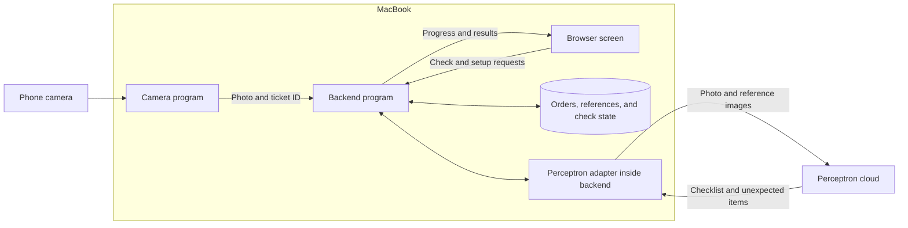
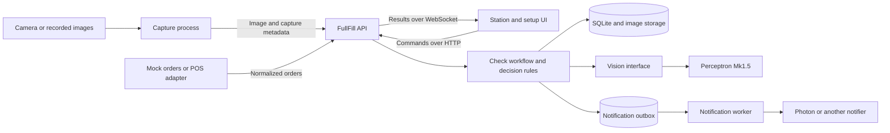

# FullFill system design proposal

**Main document: [order-checker.md](../order-checker.md).** It owns the product requirements, scope, workflow, team assignments, and acceptance targets. This document explains how to implement that plan with separate code modules and replaceable integrations. If the documents disagree, follow `order-checker.md` and update this design. Python **3.13** remains the agreed runtime for all Python components. The architecture below is the target, not a claim that the product is implemented.

**Current implementation:** the repository contains minimal app entry points, shared models/interfaces, generated TypeScript, and placeholder modules. Product behavior is intentionally left for the team. See [team-development.md](team-development.md) for the actual scaffold and available commands; the larger tree and workflow below remain implementation targets.

## Plain language overview

FullFill helps restaurant staff check that an order has the right items before it leaves. A phone points at a packing mat, and a web page on a MacBook shows the result. **Perceptron is the AI that looks at the photos.** FullFill manages the orders and decides whether what Perceptron sees matches what was ordered.

During setup, the restaurant photographs its menu items using the station camera and gives each one a name. These become the **reference photos**: examples showing what that restaurant's ranch cup, fries, or drink looks like. We send the relevant examples with each check; we are not training a new model. Adding a menu item means adding its name and photos to this library, with a target of under one minute from enrollment to a usable item.

FullFill also needs a digital list of what each order contains. We start with sample orders for the demo; later, an order-system connection can supply real ones. The ticket's QR code identifies which saved order to use, so Perceptron does not have to read the whole receipt to discover what was ordered.

Here is what happens during a check:

1. A worker places one order's items and ticket on the mat, with the items spread out so they can be seen.
2. The camera waits for the scene to settle, takes a photo, and reads the QR code. If it cannot identify the ticket, the worker selects the order on screen.
3. The backend finds the saved order and sends Perceptron the captured image plus reference photos for the relevant items. The live camera preview stays local; we send individual check photos to Perceptron.
4. Perceptron returns a short checklist: each expected item is `present`, `missing`, or `unsure`, with unexpected items listed separately. The expected quantity is part of each target, so “present” means the required quantity is satisfied. The backend validates the checklist and derives the screen state.
5. The screen updates: **green** means the required visible or labeled items match, **red** means a definite mismatch, and **amber** means a person needs to check something. A connection or processing failure is shown separately and cannot count as a successful check.

For example, an order needs two ranch cups, but the photo clearly shows only one. The checklist flags the ranch target as missing; an optional observed count lets FullFill say “Missing: one ranch cup.” The worker adds the cup while the order remains laid out, the camera waits for stillness again, and a new check can turn the screen green. A Check/Recheck button is the fallback when automatic capture cannot identify a correction safely. If a cup might be hidden or the image is unclear, the system asks for a clearer view instead of assuming it is missing. It checks visible items and labels; it cannot confirm what is inside a closed container.

Each result belongs to a particular order and photo. The screen can show that photo during the active check, even if the worker has started bagging. An unresolved red warning stays attached to the order when the mat clears. An old response cannot replace a newer check. Amber items have a one-tap confirmation that is logged as human acceptance, separately from an AI-assisted pass. There is no required Release button in the MVP.

The code has three main parts:

| Part | In everyday terms |
| --- | --- |
| Camera program | Handles the phone feed, decides when to take a photo, prepares the image, and identifies the ticket. |
| Backend | The coordinator: manages orders and reference photos, asks Perceptron for the checklist, validates it, and logs checks under the data policy below. |
| Web screen | Shows the queue, live preview, captured evidence, and results. It also provides menu setup, recheck, and manual acceptance controls. |

All three run on the MacBook, with the screen opened in a browser. Perceptron runs in the cloud, so real image checks need an internet connection. Reference photos are stored locally. Demo history uses fake tickets and deliberately sanitized fixtures; real restaurant check photos and customer/ticket details are not retained. Photon is optional and supports manager texts for errors and overrides, shift summaries, and menu enrollment by text. Messaging problems do not hold up the check.

This separation lets the team work independently on the station/camera, backend/Perceptron/Photon, and evaluation work areas assigned in the main plan. They agree on the information passed between their parts. For example, the screen developer can use a sample “missing ranch cup” result while the backend developer works with saved photos.

Connections to Perceptron, restaurant order systems, and messaging services each live in a small module called an **adapter**. An adapter translates a service's inputs and outputs into FullFill's agreed format. If a provider changes its API, its adapter handles that change while the screen and order-comparison logic keep using the same format.

## Project architecture in plain language

The project lives in one repository and runs as a camera program, a backend program, and a browser screen. The backend is the central connection point: the camera sends it photos, the screen sends it worker actions, and it coordinates storage and Perceptron requests.



The Perceptron adapter is a module inside the backend, so it starts with the backend. Optional manager alerts also start from the backend after a result is saved. The local camera feed and stored orders stay available when the internet drops. New Perceptron checks are unavailable until connectivity returns; workers can record manual acceptance separately.

The proposed code areas follow those boundaries:

| Code area | What belongs there | Main owner |
| --- | --- | --- |
| `apps/web/` | Everything the worker sees and clicks: station screen, order queue, and menu setup | Frontend person |
| `apps/capture/` | Camera access, stillness detection, QR reading, image preparation, and preview | Station/camera person |
| `apps/api/fullfill/` | Orders, check coordination, comparison rules, saved results, and API routes | Backend person |
| `apps/api/fullfill/adapters/vision/` | Perceptron prompts, requests, and response validation | Backend/vision person |
| `packages/contracts/` | Shared definitions of an order, capture, observation, and result | Agreed together; backend person maintains |
| `fixtures/` and `eval/` | Example data for independent development and labeled photos for measuring accuracy | Everyone contributes; evaluation person owns the harness |

Inside the backend, separate code by its job. **Routes** receive requests, **application services** coordinate the steps of a check, **decision rules** compare expected and observed items, and **adapters** handle Perceptron, storage, and messaging. This lets someone change a prompt without editing the comparison rules, or redesign the screen without editing camera code.

The connections are equally explicit. The camera and screen use the backend's **API**, an agreed set of requests and responses. The screen also receives a stream of progress updates. Backend modules call each other through small functions with agreed inputs and outputs. Only backend storage code accesses the database; the screen receives results through the API.

For example, the camera sends “here is capture 17 for order 4127.” The backend retrieves that order, asks Perceptron to inspect the image, and saves the comparison. The screen receives “check 23 found one missing ranch cup.” Each part knows only the information needed for its job, which is what allows teammates to build and test their parts separately.

The [detailed repository scaffold](#repository-structure-and-independent-work) below maps these areas to individual files and development commands.

## Technical approach

Build FullFill as a modular Python 3.13 backend, a separate Python 3.13 camera process, and a React station UI in one repository. **Perceptron Mk1.5 is the selected vision provider for the MVP.** Keep its integration behind a small interface owned by FullFill. This gives the group independent pieces to develop while keeping the first deployment small enough to run on one MacBook.

The product boundary is one order on a mat, one snapshot per stable presentation or correction, a comparison against a digital order and restaurant reference photos, and a recorded outcome. Follow the main plan's [capture workflow, station states, and setup flow](../order-checker.md#4-design-set-out--snapshot--bag). Module boundaries enable parallel work without changing the plan's responsibilities or adding mandatory worker actions.

## Deployment and dependencies

Use React with TypeScript for the UI, FastAPI on Python 3.13 for the API and workflow, Python 3.13 with OpenCV for capture, and SQLite plus a local image directory for persistence. The Perceptron integration, shared contracts, and evaluation tools also use Python 3.13. Run one backend process with one managed check worker initially. Serve the built UI from the backend; a separate frontend development server is useful during development.

Use a wired iPhone through Continuity Camera, with a fixed mount and contrasting matte surface. Use another phone for the hotspot, as specified in the main plan. The local image directory holds menu references and approved demo/evaluation fixtures; live restaurant check images stay transient.

FastAPI supports composing routers from separate modules in one application, which fits these boundaries. The workflow and decision rules should remain callable without HTTP. [FastAPI application structure](https://fastapi.tiangolo.com/tutorial/bigger-applications/)



The boxes inside the backend are Python modules, not separate network services. Capture runs separately because camera access and frame processing have their own lifecycle. When Photon is enabled, its Spectrum integration runs in the small TypeScript bridge described by the main plan. The backend selects adapters in one composition module at startup.

### Runtime lifecycle

The local deployment serves the built UI and API from `http://127.0.0.1:8000`. During development, a Vite frontend server proxies `/v1` requests and event streams to that API. The camera worker exposes its preview only on a configured loopback address; the backend proxies it through the station preview route. The browser has one application origin and never receives provider credentials. Vite produces the static frontend assets used by the local deployment. [Vite production build](https://vite.dev/guide/build)

`main.py` exposes an application factory. `bootstrap.py` constructs settings, repositories, the asset store, the Perceptron client, and application services. FastAPI's lifespan context starts and stops the check worker and notification worker, and closes database/network resources. A failed worker makes readiness fail until it is restarted or the application restarts. Run one API worker process initially; enabling multiple Uvicorn workers would otherwise duplicate the background loops. [FastAPI lifespan](https://fastapi.tiangolo.com/advanced/events/)

Use one long-lived `httpx.AsyncClient` inside the Perceptron adapter so inference requests do not block the API event loop. Run synchronous database transaction functions in a bounded thread pool, creating and closing their connections inside the same thread. OpenCV processing stays in the separate capture process. [HTTPX async client](https://www.python-httpx.org/async/)

On shutdown, stop accepting checks, finish or cancel active work within a bounded grace period, discard transient images, and release the camera. On startup, inspect any permitted persisted jobs: interrupted running work becomes a recorded technical failure; expired jobs or jobs whose transient image was lost fail and require a fresh capture. Only fresh, still-current jobs with available permitted inputs may run. Real-restaurant sessions do not restore order-linked history; show a session-reset notice and require fresh checks for active orders. Liveness reports whether the process is running. Readiness reports database, asset-directory, configuration, and worker health without making a paid Perceptron request. Camera health is reported separately.

## Component boundaries

| Component | Owns | Contract with the rest of the system | Development substitute |
| --- | --- | --- | --- |
| Station UI | Order queue, capture preview, results, setup forms, explicit overrides | HTTP commands and versioned station events | Recorded API responses and event stream |
| Capture process | Camera access, mat crop, stillness, QR decoding, image preparation | Uploads `Capture`; accepts snapshot requests | Recorded image sequence |
| Orders and catalog | Order revisions, item IDs, quantities, reference sets, external item mapping | `OrderSnapshot`, `ReferenceSet`, catalog commands | Seed menu and mock orders |
| Check workflow | Queuing, pinned inputs, timeouts, retries, results under the data policy | `CreateCheckRequest` to `CheckResult` | Fake vision and in-memory repositories |
| Decision rules | Checklist aggregation, quantity consistency, ambiguity handling | Pure function from order and observations to verdict | JSON fixtures |
| Vision adapter | Provider SDK, prompt, response parsing, image encoding, usage metadata | `VisionProvider.inspect(input) -> Observations` | Deterministic fake provider |
| Notifications | Error/override alerts, shift summaries, delivery deduplication; inbound enrollment uses catalog services | `Notifier.send(notification)` and normalized enrollment requests | Recording notifier and fake inbound messages |
| Evaluation | Labeled cases, accuracy, latency, cost comparison | Same vision interface and decision function as the app | Saved responses |

Only the backend owns the database. Capture, UI, and notification bridges use the API; they do not import backend internals or query its tables. Business modules use explicit service methods rather than modifying each other's tables. Vendor SDK imports and vendor payloads stay inside their adapters.

## Contracts to agree on first

Define shared boundary models with Pydantic v2 in a small Python contracts package, export JSON Schema and OpenAPI, and generate the TypeScript client/types. Pydantic models can generate JSON Schema for these boundaries. WebSocket event models need a separate JSON Schema export because HTTP OpenAPI does not describe their messages. Maintain one source for wire schemas and check generated changes in CI. Version JSON bodies and events with `schema_version`; GET routes use the `/v1` path. Breaking changes require a new major version. [Pydantic JSON Schema](https://docs.pydantic.dev/latest/concepts/json_schema/)

| Model | Essential fields and meaning |
| --- | --- |
| `OrderSnapshot` | Internal `order_id`, external source/key, `revision`, lines with stable `line_id`, `item_id`, quantity, and verification scope |
| `MenuItem` | Stable `item_id`, display name, label aliases, `verification_mode` such as visible item, label, or container count |
| `ReferenceSet` | `item_id`, immutable revision, image asset IDs, camera profile and notes about distinguishing features |
| `Capture` | `capture_id`, `station_id`, camera session, scene sequence, capture timestamp, image asset ID, QR candidate and binding method |
| `CreateCheckRequest` | Client-supplied station ID, order ID/revision, expected disposition revision, capture ID |
| `CheckSpec` | Server-created `check_id`, pinned order/reference revisions, capture ID, generation, disposition guard, policy/prompt versions, deadline |
| `VisionInput` | Prepared image, ticket targets including required quantities, pinned reference images, verification scope; excludes provider credentials |
| `Observations` | One `present/missing/unsure` status per target, optional observed quantity or short reason, unexpected items, optional scene uncertainty, provider metadata; later Point results are separate |
| `CheckResult` | `check_id`, order revision, capture ID, verdict, line discrepancies, timestamps, latency, usage, model/prompt/policy versions |
| `Override` | Order revision, check ID, confirmed target IDs, station/operator reference, reason code, timestamp, explicit human disposition |
| `StationEvent` | Event ID with session epoch, schema version, station/order/check IDs, event type, state revision, payload; retention follows the data policy |

For example, an order for two ranch cups carries `expected_quantity: 2` in the model input. `present` means both required cups are confirmed; one clearly visible cup is `missing`, and a potentially hidden cup is `unsure`. Before inference, group identical order lines into verification targets by item, label/variant, and verification mode, preserving their source line IDs. Require one checklist entry per target. Optional observed counts must agree with the status; a contradiction (or a target the answer leaves out) makes that target `unsure`, never a pass. Report extra units as unexpected items even when the required quantity is present. Use stable IDs for matching. Unknown item identity stays unknown instead of being forced to the closest expected name.

The vision interface accepts a prepared image, expected ticket items and quantities, reference images, and verification scope. It returns the main plan's item checklist, never a final green/red UI state. The backend validates and aggregates that checklist. A flagged result can trigger the planned background Point call; its coordinates are normalized to the same cropped image, and adapters translate vendor coordinates. A missing highlight must not delay or invalidate the primary checklist.

Perceptron is the MVP adapter. Its quickstart documents image inputs, multiple assets, and JSON Schema output. Keep the exact model ID, request format, prompt, and parsing in that adapter and validate it with real order photos before treating accuracy or latency as established. `FakeVision` is an explicitly selected development substitute, never an automatic fallback after a real provider failure. [Perceptron quickstart](https://docs.perceptron.inc/perceptron-mk1.5/index)

### Example data crossing the boundaries

IDs below are illustrative. Production IDs are opaque strings; timestamps use UTC with a timezone. Counts are non-negative integers, expected quantities are positive, and unknown observed quantities use `null`. Clients cannot set the server's check generation, pinned references, or final verdict.

A UI or camera workflow submits the following JSON to `POST /v1/checks`, with a unique `Idempotency-Key` header:

```json
{
  "schema_version": 1,
  "station_id": "station_1",
  "order_id": "order_4127",
  "order_revision": 3,
  "expected_disposition_revision": 5,
  "capture_id": "capture_17"
}
```

The API responds with `202`, a check ID, execution status, and the newly accepted disposition revision. The backend prepares a target for two ranch cups and includes that quantity in the Perceptron input. The adapter's normalized observation could be:

```json
{
  "schema_version": 1,
  "capture_id": "capture_17",
  "targets": [
    {
      "target_id": "target_ranch",
      "status": "missing",
      "observed_quantity": 1,
      "reason": "One of two required cups is visible"
    }
  ],
  "unexpected_items": []
}
```

This is the normalized application payload, not a requirement to repeat metadata in the model's answer. Keep the provider response short: target ID and status, with counts or short reasons only where useful. If a count cannot be established, use `null` or omit it; never turn unknown into zero. A `missing` status without a count can name the unsatisfied target but cannot invent an exact shortage. The adapter attaches trusted capture IDs and provider metadata itself. Checklist judgments must be evaluated on held-out photos.

The resulting UI payload, emitted inside a station event, could be:

```json
{
  "schema_version": 1,
  "check_id": "check_23",
  "capture_id": "capture_17",
  "order_id": "order_4127",
  "order_revision": 3,
  "execution_status": "completed",
  "verdict": "fail",
  "disposition": "needs_review",
  "disposition_revision": 7,
  "discrepancies": [
    {
      "target_id": "target_ranch",
      "line_ids": ["line_2"],
      "kind": "missing",
      "expected_quantity": 2,
      "observed_quantity": 1,
      "missing_quantity": 1
    }
  ]
}
```

The example assumes acceptance advanced disposition revision 5 to 6 and completion advanced it to 7. Result text such as “Missing: one ranch cup” is derived from these structured fields and catalog names, so the UI does not parse a model's prose.

## Interface implementations

Separate interfaces at two levels: HTTP between running apps, and typed Python calls inside the backend. An interface defines the accepted inputs and outputs; an adapter implements that agreement for a particular provider. The backend owns these interfaces so replacing a vendor does not redefine the application's data model.

| Backend interface | Input and output | Implementation examples |
| --- | --- | --- |
| `OrderRepository.get(order_id)` | Order ID to an order snapshot or not-found result | SQLite, in-memory fixture store |
| `Catalog.get_references(item_ids)` | Item IDs to descriptions and immutable reference sets | Local catalog with seeded or enrolled items |
| `VisionProvider.inspect(request)` | Prepared image, candidates, and references to observations | Perceptron, another model, deterministic fake |
| `CheckRepository.save(result)` | Record a result under the active data policy | SQLite demo history, transient restaurant session |
| `Notifier.send(notification)` | Normalized alert to delivery result | Photon, another messenger, recording notifier |

Repository writes participate in the workflow's transaction; saving a result, updating eligible order state, and inserting events/outbox entries follow the atomic completion rule below. POS integrations normalize incoming orders through the order application service; storage repositories do not call POS APIs.

For example, the Python vision interface would be:

```python
from __future__ import annotations
from typing import Protocol


class VisionProvider(Protocol):
    async def inspect(self, request: VisionInput) -> Observations:
        ...
```

`VisionInput` and `Observations` are FullFill-owned types. Implement `PerceptronVision` and `FakeVision` against the same method; any future provider must satisfy that contract. The startup module selects an implementation and passes it into the check workflow. The workflow calls `vision.inspect(request)`, then passes the returned observations to `compare_order(order, observations)`; provider HTTP calls and response parsing remain inside the adapter. The notification worker separately receives a `Notifier` implementation.

Define the interfaces in `ports/`, shared boundary schemas in `packages/contracts/`, and concrete implementations in `adapters/`. Decision rules depend only on domain data. Application code depends on the interfaces; only `bootstrap.py` wires concrete adapters into the application. This keeps vendor-specific imports out of routes, decision rules, and UI code.

For independent development, each interface needs a fake implementation or example payloads covering success, uncertainty, and failure. The UI developer can replay result events while the vision developer runs saved images through the real adapter. Both validate their outputs against the same schemas.

## Perceptron request and validation

Implement `PerceptronVision` with an async HTTP request to `https://api.perceptron.inc/v1/chat/completions`, model `perceptron-mk1.5`, and a server-side bearer API key. The provider uses chat-completion messages containing text and image inputs. [Perceptron request example](https://docs.perceptron.inc/perceptron-mk1.5/index)

The adapter builds a fresh request for each check:

1. Put the captured order image first and identify it as the only image whose objects should be counted.
2. Add each ticket target's stable ID, name, expected quantity, label aliases, verification scope, and labeled reference images. Include reference photos only for items on the current ticket. References illustrate appearance and must not count as observed order items.
3. Use Text output with a compact `VisionChecklist` schema: one `present`, `missing`, or `unsure` entry per target, plus unexpected items. Counts and brief reasons are optional details for discrepancies or uncertainty. Do not require verbose evidence records, coordinates, tool calls, or a final pass/fail judgment in the primary response.
4. Keep **reasoning off**, with no boxes or points in the first call and a small configurable `max_completion_tokens` limit. Prototype the request in the Perceptron playground and use its Export output to confirm the exact reasoning/output settings before implementation.
5. Request JSON Schema output with `response_format.type = "json_schema"`, a named schema, and `strict: true`. Accept only a completed answer with `finish_reason = "stop"`, no tool calls, and JSON that validates locally. A syntactically valid answer still needs semantic validation. [Perceptron structured output](https://docs.perceptron.inc/perceptron-mk1.5/capabilities/structured-outputs)

`VisionChecklist` contains only model-produced fields. The adapter converts it into `Observations` by attaching the trusted capture ID, provider/model identity, prompt version, request ID when supplied, token usage, and elapsed time. Check that target IDs match the requested set exactly, statuses are valid, and any supplied counts agree with the status and required quantity. Unknown target IDs, malformed JSON, and truncated output are invalid responses. Duplicate entries, contradictory counts, and missing targets make the affected target `unsure` (amber) instead of failing the whole check. The prompt must prohibit counting an object for multiple targets; unresolved matching ambiguity becomes `unsure`.

Keep the prompt generic in a versioned text file beside the adapter; item names and photos come from catalog data, never item-specific code. Record the prompt hash in permitted evaluation logs. Bound both the number and bytes of reference images. If an order exceeds the input budget, return an explicit unsupported-input result instead of silently dropping targets. Start with one station-camera reference per item and allow 2–3 for difficult items within that budget.

After publishing a flagged checklist, make the planned follow-up **Point** call for visible flagged or unexpected items. Use **Box** only if a point is not clear enough; skip Polygon. This is a separate background step sharing the call cap and cooldown, with lower priority than primary checks. Never invent a location for a truly missing object. Keep the text result usable if highlighting fails, and ignore highlights from an older check. Match the main plan's compact-output latency goal by measuring tokens and end-to-end timing in T1.

Map provider failures to typed application errors: `ProviderUnavailable`, `ProviderRateLimited`, `ProviderTimeout`, `InvalidVisionResponse`, and `InputBudgetExceeded`. Retry transient transport failures, rate limits, or server errors only when the remaining deadline and call budget allow it; respect `Retry-After`. Authentication failures and invalid structured output need correction, not an unbounded retry loop. Every network attempt consumes a reserved application call-budget slot, even if its eventual provider billing is unknown. Cancellation cannot guarantee that a request already received by Perceptron stops processing or billing.

## One check from capture to result

1. The worker lays out an order. Capture waits for about 0.5 seconds of stillness, reads the QR locally from that same frame, crops the mat, masks the ticket area, and downscales to about 1024 px before uploading. A dedicated ticket area makes masking predictable. If the order cannot be identified, the UI requests manual selection; the backend never guesses from queue position.
2. `POST /v1/captures` uploads image bytes and metadata and returns a capture ID plus any resolved order context. The backend resolves the QR token to an order. Treat QR contents as an opaque identifier, never a URL to fetch. For manual selection, record that binding explicitly.
3. `POST /v1/checks` references the capture and order revision with an idempotency key. In one database transaction, validate eligibility, pin the order/reference inputs, create a queued check, and assign the next check generation. Return `202` and `check_id` promptly.
4. A managed worker claims the job, prepares references only for ticket items, calls the vision adapter, and validates the returned checklist. Keep quantity and identity ambiguity explicit.
5. The decision function aggregates the item statuses and any quantity discrepancies. Record every check under the data policy below. In the same transaction, update the disposition and create alert/event records only if the order revision, active check generation, and disposition revision still match. Stale results cannot trigger a new alert or overwrite a human action.
6. Publish a WebSocket event to the UI, which shows the checklist and, while available, its transient evidence image. The notification worker delivers error/override alerts independently. The background Point result can arrive later for visible flagged objects; a genuinely missing item has no location to highlight.

The verdict applies to the captured arrangement. Bagging motion must not invalidate that evidence or start repeated checks. Show its timestamp and image, and keep unresolved orders visible after the mat clears. A recheck requires the relevant order to be laid out again.

Support the main plan's correction demo: adding the missing item to the still-laid-out order triggers another check once the changed scene settles. Deduplicate unchanged scenes, allow at most one primary check in flight per order, and apply the cooldown/call cap to corrections too. Only recheck an unresolved order automatically when the same ticket and a meaningful stable correction are identifiable. Do not treat ordinary removal for bagging as a correction. If the trigger cannot distinguish the change safely, retain the warning and offer Check/Recheck with the full order laid out. Test this distinction using addition, removal, hand movement, and mat-clearing sequences. A clear mat rearms a new presentation but never resolves a red order.

For an automatic order capture, the camera process submits `/v1/checks` using the order context returned by the upload API. It does not reconstruct order contents. Unknown QR values remain unbound until the UI supplies a manual selection. Reference captures carry `purpose: "reference"` and never automatically start checks. A check request referencing the same capture and order revision is deduplicated even if the UI and camera submit it concurrently.

## State and failure rules

Keep execution status, machine verdict, and human disposition separate:

- Execution: `queued`, `running`, `completed`, `failed`, `superseded`.
- Machine verdict: `pass`, `fail`, `unsure`; absent if execution failed.
- Disposition: `pending`, `verified`, `needs_review`, `overridden`. These implement the main plan's in-progress, green, amber, red, and resolved states; `verified` or a complete recorded human override resolves the current discrepancy.

The UI uses green for a current pass, red for a definite discrepancy, amber for uncertain evidence, and an explicit unavailable/retry state for technical failure. Each amber item offers the main plan's one-tap confirmation. Record its target, timestamp, station/operator reference, and a fixed reason code such as `worker_confirmed_present`; do not require typing a reason for that action. Keep human acceptance visibly distinct from machine verification. Confirming one item does not clear other unresolved items. There is no separate Release action or release endpoint in the MVP.

Accepting a recheck suspends any earlier verification while retaining unresolved discrepancies. An override closes the older check's authority to update the disposition and can emit an override notification. Commands carry the expected disposition revision so conflicting actions are rejected rather than silently overwriting each other. A changed order requires a fresh check; a resolved discrepancy must not silently approve later content revisions.

| Condition | Required behavior |
| --- | --- |
| All required visible or labeled evidence matches | Pass, within the declared verification scope |
| Complete, unambiguous view shows a quantity or identity mismatch | Fail and name the discrepancy |
| Occlusion, unreadable label, indistinguishable packaging, incomplete evidence | Unsure; request a clearer view or human check |
| Timeout, provider outage, invalid response, exhausted call budget | Failed execution; no pass |
| New check B finishes before check A | A remains in history but cannot overwrite B |
| Order changes while inference runs | Mark the old check superseded and require a check for the new revision |
| Failed/uncertain recheck follows a red result | Preserve the unresolved discrepancy until a valid correction check or explicit override |
| UI disconnects | Reconnect from the last event ID, or fetch a fresh station snapshot if replay is unavailable |
| Notification delivery fails | Keep the result; retry delivery separately |

Unknown quantities are not zero. A partly occluded image does not prove an item is missing. One visible object must not satisfy two distinct verification targets or be counted twice within a target; instruct the model to return unsure when matching overlaps and test this explicitly. Do not claim the compact checklist mechanically proves object-level uniqueness. Numeric model confidence is diagnostic until calibrated against labeled examples. Tune ambiguity handling to keep false alarms low, as required by the main plan.

For closed packaging, verify only visible container counts or label agreement. A matching label does not establish the contents or prove that a modifier was actually followed. The UI should name the scope, for example “labels and container counts matched.”

The comparison function first validates that all target checklist entries are available. A `missing` target or confirmed unexpected item makes the result fail; otherwise any `unsure` entry or scene uncertainty makes it unsure; otherwise all targets marked `present` produce pass. A definite mismatch plus uncertainty remains fail, with both explanations preserved. `present` asserts the required quantity and visible/label scope; optional counts must support that assertion. Calculate an exact missing quantity only when an observed count is supplied. Label-only targets use label agreement as their declared scope.

Only a completed current pass can set `verified`. Accepting another check makes that verification pending; a failure cannot restore it. An order update increments its content revision and invalidates previous verification. A manually resolved order uses `overridden`, never a fabricated model pass.

## API and local camera control

The UI and camera process use HTTP commands with JSON metadata; capture uploads use multipart requests containing the image file and metadata. Commands return IDs or normalized FullFill responses. A WebSocket carries JSON state updates to the UI, matching the main plan. Vendor payloads never cross these boundaries.

| Endpoint | Purpose |
| --- | --- |
| `GET /v1/orders` | Queue with revisions and current dispositions |
| `POST /v1/orders` | Create normalized mock/manual orders |
| `PATCH /v1/orders/{id}` | Update an order using its expected revision and invalidate earlier verification |
| `GET /v1/stations/{id}` | Authoritative station snapshot for first load and reconnect |
| `POST /v1/stations/{id}/sessions` and `POST /v1/stations/{id}/heartbeat` | Register the active capture session and report camera health |
| `POST /v1/stations/{id}/capture-requests` | Request a check image or reference image |
| `GET /v1/stations/{id}/capture-requests` | Capture process polls for pending requests |
| `POST /v1/captures` | Upload an image, optionally completing a capture request |
| `POST /v1/checks` and `GET /v1/checks/{id}` | Start a check and inspect progress/result |
| `POST /v1/orders/{id}/overrides` | Record one-tap item confirmation or an explicit order override with a reason code |
| `GET/POST /v1/menu/items` | List or enroll items |
| `POST /v1/menu/items/{id}/references` | Create a new reference revision from an uploaded capture |
| `WS /v1/stations/{id}/events` | WebSocket for versioned state changes and reconnect replay |
| `GET /v1/stations/{id}/preview` | Proxy the configured local camera preview |
| `GET /v1/assets/{id}` | Serve an allowed reference, approved fixture, or still-active transient capture by asset ID |
| `POST /v1/shifts/{id}/summary` | When Photon is enabled, enqueue one deduplicated end-of-shift summary |
| `POST /v1/integrations/photon/enrollments` | When enabled, accept a verified bridge request into the normal catalog enrollment service |
| `GET /health/live` and `GET /health/ready` | Process liveness and application readiness |

Use ordinary HTTP for commands and WebSocket messages for updates. Keep the event envelope independent of the transport so a future transport change does not affect domain rules. A local low-resolution MJPEG preview can be served by the camera process through the backend, separately from result events. Do not send preview frames to the vision provider. Snapshot requests must return a newly captured frame with a request ID and timestamp, so setup never silently reuses an old preview.

### HTTP behavior and events

Capture uploads contain multipart fields `image` and `metadata`, where metadata is serialized JSON. Validate the decoded image format, dimensions, byte limit, station session, capture purpose, and timestamp before accepting it. Generate asset IDs on the server, strip image metadata, and compute a content hash. Apply the data policy before choosing transient memory or persistent storage; HTTP upload parsing and logs must not spill real check images or request bodies to disk. A camera session uses increasing scene sequence numbers; `(station_id, session_id, scene_sequence)` uniquely identifies an automatic capture. A manual capture request can be fulfilled only once.

Mutation requests carry an `Idempotency-Key`. Persist its operation scope, normalized request hash, and response in the same transaction as the mutation. Repeating the same key and body returns the recorded response; reusing a key with different input returns `409`. A unique check constraint on station, capture, order ID, and order revision also prevents accidental repeat inference under different keys. A capture's order/revision binding becomes immutable when resolved or manually assigned; attempting to reuse it for another order or a later revision returns `409`. Rechecks use fresh captures. Retries never create a second accepted check.

Use `404` for unknown resources, `409` for stale revisions or conflicting commands, `413` for oversized images, `422` for invalid payloads, and `429` for admission limits. A provider outage after `202` is represented by the check's failed execution status, not a retroactive HTTP error. Error bodies contain `schema_version`, a stable `code`, a readable `message`, `request_id`, and optional field details; omit secrets and raw provider bodies.

Each WebSocket message has an `event_id`, an event type such as `check.queued`, `check.completed`, `check.failed`, or `order.updated`, and a versioned JSON envelope. The station snapshot returns both its current state and an event cursor from one consistent read. The cursor includes a session epoch so IDs cannot collide after a transient-session restart. The UI connects with an `after` cursor, deduplicates event IDs, and applies only newer revisions for each order. Replay events after that cursor; if history has expired or the session has restarted, send `resync_required` and fetch a fresh snapshot. Heartbeats detect disconnection, and polling the station snapshot is a fallback. Retain the authoritative event history according to the data policy; an in-memory wakeup alone is never the source of current state.

### Camera and frontend behavior

The capture loop has `waiting`, `stabilizing`, `submitted`, `correction_candidate`, and `disconnected` states. Compare downsampled grayscale frames inside the calibrated mat area, require low motion for about 500 ms, and reject blurred or unreadable frames. Stillness is a trigger heuristic, not proof that an image is sharp or that hands have left. After submission, ignore ordinary bagging motion; only a stable correction candidate for an unresolved order, an empty-mat/new-presentation cycle, or an explicit capture request can rearm a check. Track the last submitted scene signature so unchanged frames never create repeated paid calls.

Store the mat crop, ticket mask, camera identifier, orientation, and calibration revision as a camera profile. Attach that revision to captures and references. If the camera angle or crop changes, require replacement references before using the affected items. Reference mode pauses automatic checking so photographing a new item cannot accidentally create an order result. Use one reference initially, 2–3 for difficult items, and verify enrollment takes under one minute. If the camera disconnects, clear its last-frame buffer, report stale preview status, and require a new frame after reconnection.

The React app has separate station, queue, and catalog/setup features. Keep API calls in the generated client, WebSocket handling in one station-event hook, and rendering in components. The backend is the authority for verdicts; the frontend never optimistically marks a check passed. Display the transient evidence snapshot separately from the live preview so a result arriving after bagging is clearly tied to what was photographed. When its bytes are discarded, retain the active checklist and timestamp without an image. One-tap confirmation and other override commands include the expected disposition revision and handle `409` by refreshing the order.

## Persistence and operational limits

Use repositories for orders/lines, menu items/reference revisions, captures, checks/results, overrides, station events, and notification outbox entries. Keep immutable order/reference revisions so checks use consistent inputs. `AssetStore` separates persistent menu references and approved fixtures from transient check images; the image's purpose and data mode determine where it may live.

### Data policy from the main plan

The main plan requires both check logging for evaluation and, for real restaurants, storing nothing from the ticket beyond the item list. Apply these requirements explicitly:

- **Demo/evaluation:** use fake tickets and deliberately sanitized fixtures. SQLite may retain their check results, revisions, events, and overrides for debugging and evaluation. Persist a check image only when explicitly enrolled as a sanitized evaluation fixture; ordinary live snapshots remain transient.
- **Real restaurant:** persist menu/reference data and anonymous item lists only from order content. Customer names, raw tickets/QR contents, external order identifiers, check photos, and order-linked history are not retained on disk. Keep active order bindings, check state, events, and override logs in transient session storage; discard them when no longer needed. Only aggregate counts, timing/usage statistics, and global call-budget counters may persist without order/customer links. A restart requires fresh order identification and checks, not restored green states.
- **Image lifecycle:** crop/mask ticket details before inference, remove image metadata, and keep live images only in bounded memory while needed for the active checklist, Point follow-up, or current screen. Discard them on completion of those uses or a hard expiry; never write them through upload temp files, debug logging, caches, or backups. Retain the checklist while the order remains unresolved even after its image expires.
- **Reference library:** menu photos are intentional setup assets, separate from customer/order captures. Strip unrelated ticket/customer information before saving a reference, including images submitted through Photon.

Do not treat a configurable photo-retention period as permission to archive real restaurant checks. A future persistent audit-history feature requires changing the main plan first. The table below describes the persistent **demo/evaluation** schema; order-linked records use transient equivalents in real-restaurant mode. This distinction must be implemented before using real customer orders.

### Initial database schema

The MVP database belongs to one restaurant. Keep database row models inside the persistence adapter; HTTP responses use explicit contract models rather than exposing database rows.

| Table or group | Important columns and constraints |
| --- | --- |
| `stations` | Station ID, active capture session, camera profile revision, last heartbeat |
| `orders` | Order ID, source/external key, current order revision, disposition revision, active check ID/generation, disposition; unique source/external key |
| `order_versions`, `order_lines` | Immutable order snapshots and line quantities; keys include order ID and revision |
| `menu_items`, `reference_sets`, `reference_images` | Stable item IDs, immutable reference revisions, verification mode, camera profile, ordered asset links |
| `assets` | Persistent reference/approved-fixture asset ID, relative storage key, hash, MIME type, dimensions, purpose; live captures use transient handles |
| `capture_requests`, `captures` | Request/session IDs, sequence, purpose, image asset, timestamps, resolved order binding; unique fulfilled request and capture sequence |
| `checks`, `check_results` | Frozen check specification, execution status, deadline, generation/guards, normalized observations, verdict, timing and provider metadata |
| `provider_attempts` | Check ID, attempt number, reserved/start/end times, outcome, reported usage; unique check/attempt pair |
| `idempotency_records` | Station/operation/key, request hash, response status/body; unique scoped key |
| `overrides` | Order revision, check ID, confirmed targets, station/operator reference, reason code, creation time |
| `station_events` | Increasing event ID, station/order IDs, scoped state revision, type, versioned JSON payload |
| `notification_outbox` | Unique alert deduplication key, payload, delivery state, attempts, next retry time, provider receipt when available |
| `shift_counters` | Shift ID and aggregate error/override/item-category counts; no customer/order links in real mode |

Enable foreign-key enforcement per connection, use WAL on the local disk, and keep write transactions short with a bounded busy timeout. SQLite permits only one writer at a time, so no database transaction may span a Perceptron or messaging request. Implement ordered SQL migrations with a schema-version table; startup checks the version and the launcher runs migrations before starting workers. [SQLite isolation](https://www.sqlite.org/isolation.html)

### Check transactions

1. **Accept:** in a short write transaction, first return any matching idempotent response or already-accepted capture/order check. Only new commands proceed to capture age/session/binding checks, expected-revision checks, and admission limits. Pin the order/references/policy, increment the generation and disposition revision, insert the queued check and event, and store the command response. This ordering lets a retry retrieve its original response even though acceptance changed the order's state revision. A new queued check may supersede older queued work for the same order.
2. **Claim and attempt:** atomically claim a queued, unexpired check and reserve a provider-attempt budget slot. Commit before loading/encoding images or awaiting Perceptron. Recheck eligibility and image availability immediately before dispatch. For the MVP, one global inference slot bounds concurrency; background Point/Box requests use the same limiter.
3. **Complete:** record the result and attempt outcome in the permitted store, then compare the order revision, active check ID/generation, and disposition guard in the same transaction. If they still match, apply the transition and append station events/outbox entries. Otherwise keep the result as superseded under the same data policy. Technical failures use the same guard and preserve any unresolved discrepancy.

The storage interface also exposes a unit of work that groups repository writes into one transaction. Application services own transaction boundaries; repositories never independently commit pieces of a check completion. Real-mode order-linked transactions use transient storage under the same interfaces; persistent aggregate budgets contain no order link and are conservatively reserved before dispatch. Tests should exercise competing check, override, and order-update commands against a temporary SQLite database and the transient implementation.

For persistent reference/approved-fixture images only, validate them, write a temporary file, and atomically rename it before committing an asset row. A database failure can leave an unreferenced file, which cleanup removes later. Live check images use memory-backed handles with bounded size and lifetime. When bytes expire, fail any dependent unfinished work and show an unavailable-image placeholder; never fabricate a new image for an old result.

Record accepted jobs before acknowledging them, durably where the data policy permits and otherwise within the active session. Use a single backend worker initially and claim jobs transactionally. On restart, fail interrupted work and queued work with expired or missing inputs; real-mode session loss requires fresh checks. SQLite is the initial persistent implementation behind repository interfaces. Moving to Postgres requires migrations and concurrency testing without changing the UI or vision contract or widening retention permissions.

Enforce a server-side concurrency limit, cooldown, per-order attempt limit, and persisted total-call budget. Reserve an attempt before each provider request, including retries and Point/Box follow-ups. Apply a deadline; retry only appropriate transient failures within that budget. Ignore late completions after a check is superseded or timed out. Capture-side debouncing improves efficiency but never replaces backend limits.

Write alerts into an outbox in the result transaction. Deduplicate by order revision, discrepancy episode, and notification type, so repeated views of the same error do not text repeatedly. A new episode starts after resolution and a later recurrence. Use provider idempotency keys when supported. A provider accepting a message just before a crash can still cause a duplicate if it lacks idempotency; do not promise exactly-once delivery.

Bind local components to localhost initially and keep API credentials server-side. Before a remote station or public webhook is enabled, add station authentication, transport security, and webhook verification at that boundary. Keep the camera aimed only at the mat, and apply the image/data policy to inference, logs, storage, and messaging.

### Optional Photon integration

Photon is optional for the core checker, but its scope follows the main plan when enabled:

1. **Error and override texts:** send the discrepancy or human-confirmation event after state is recorded. Use a session order reference and item names; omit customer information. Deduplicate repeated red results for the same unresolved discrepancy and log delivery status under the data policy.
2. **End-of-shift summary:** aggregate caught errors, overrides, and commonly missed items. Queue one summary per shift/recipient at shift close through the same notifier/outbox, with retries and a deduplication key. Count discrepancy episodes rather than repeated rechecks.
3. **Enrollment by text:** the TypeScript bridge validates incoming messages and normalizes the item name/photo into the same catalog enrollment service as the setup screen. The supplied reference must come from the station-camera view and pass the same validation. Publish the new reference revision without restarting the backend and include this route in the under-one-minute enrollment test.

The bridge handles Photon-specific credentials, webhooks, and message formats. The Python backend owns catalog updates, notification meaning, and shift aggregation. A Photon outage cannot block the station checklist or local enrollment; make undelivered messages visible and retry within a bound. In real mode, order-linked outbox entries remain transient while anonymous shift totals can persist.

## Repository structure and independent work

Follow the [roles in the main plan](../order-checker.md#10-roles). A, B, and C below are shorthand for those work areas, not a competing assignment. Keep the UI, camera, vision adapter, backend, and evaluation boundaries separate even when one person owns more than one module; the team can reassign a module without changing its interface.

| Person | Owns | First deliverable |
| --- | --- | --- |
| A — Station and capture (William) | Station/setup UI, camera capture, stillness/correction trigger, QR decoding, image preparation | Replay/live capture plus a screen using fake orders/results |
| B — Backend, vision, and Photon (Roy) | Orders/tickets, API, catalog/storage, check workflow, Perceptron adapter, notifications | A complete fake check, then the real checklist request through the same interface |
| C — Evaluation (Rishabh) | T1–T3, held-out cases, detector baseline, names-only comparison, ambiguity thresholds, cost | A repeatable evaluation harness calling the same vision interface as the app |

```text
.python-version              # Shared Python 3.13 runtime pin
pyproject.toml               # B: Python workspace and shared tool settings
uv.lock                      # B: Locked Python workspace dependencies
Makefile                     # B: Shared setup, dev, test, build, serve tasks
.env.example                 # B: Documented settings, no real credentials
.gitignore                   # B: Exclude secrets, local assets, DBs, build output
.github/workflows/ci.yml     # B coordinates; A/C contribute their checks
apps/
  web/                       # A
    package.json
    package-lock.json
    vite.config.ts
    src/
      api/generated/         # Generated types/client; never hand-edit
      api/station-events.ts  # WebSocket replay, reconnect, and polling fallback
      features/station/      # Preview, checklist, fallback check, one-tap confirmation
      features/catalog/      # Item enrollment and reference capture
      features/orders/       # Queue and order details
      mocks/                 # Fixture HTTP responses and event streams
  api/
    pyproject.toml
    fullfill/
      main.py                # B: Application factory and lifespan
      settings.py            # B: Validated configuration
      bootstrap.py           # B: Concrete adapter wiring
      http/                  # B
        orders.py
        catalog.py
        captures.py
        checks.py
        stations.py          # Sessions, heartbeat, snapshot, preview
        events.py
        health.py
      application/           # B
        submit_capture.py
        start_check.py
        check_worker.py
        complete_check.py
        enroll_item.py
        notification_worker.py
        close_shift.py       # Aggregate counts and enqueue one summary
      domain/                # B: Pure rules, no HTTP or vendor imports
        verification_targets.py
        compare_order.py
        transitions.py
      ports/                 # B maintains; agree with consumers
        vision.py
        repositories.py
        unit_of_work.py
        assets.py
        notifier.py
      adapters/
        vision/              # B
          fake.py
          perceptron.py
          prompt_v1.txt
          response_validation.py
        orders/              # B: Mock orders and later POS translation
        notifications/       # B: Recording notifier and optional Photon
        persistence/         # B
          sqlite.py
          repositories.py
          local_assets.py
          transient_session.py # Real order state and live image handles
    migrations/              # B: Ordered SQL migrations
  capture/                   # A
    pyproject.toml
    fullfill_capture/
      __main__.py
      sources.py             # OpenCV and recorded-image implementations
      trigger.py             # Stable presentation/correction; suppress bagging repeats
      prepare_image.py       # Crop, mask, orientation, resize
      qr.py
      backend_client.py
      preview.py
  photon_bridge/             # B: Optional TypeScript alerts and inbound enrollment
packages/
  contracts/                 # Agree together; B maintains
    pyproject.toml
    fullfill_contracts/
      orders.py
      catalog.py
      captures.py
      checks.py
      vision.py
      events.py
      errors.py
    generated/               # Committed OpenAPI and event JSON Schema
scripts/                     # B coordinates
  dev.py                     # Start/stop local processes and wait for health
  export_contracts.py
  seed_demo.py
fixtures/                    # Everyone: Sanitized examples
  orders/
  images/
  observations/
  events/
eval/                        # C
  manifest.jsonl             # Cases, labels, splits, reference-set versions
  run.py
tests/
  domain/                    # B
  api/                       # B
  persistence/               # B
  capture/                   # A; C supplies stress-case fixtures
  vision/                    # B; C supplies labeled evaluation cases
  contracts/                 # All consumers
  integration/               # B coordinates with A/C
data/                        # Local runtime directory; ignored by Git
docs/
  system-design.md
```

This is the target folder layout. The current scaffold implements only its entry points, shared contracts/interfaces, and module placeholders; see the team development guide for what exists. A fourth contributor could take either the capture module or vision adapter without changing the shared contracts. Component ownership does not require a separate server for each person.

Before splitting up, agree on four contracts together: the camera upload, the order with quantities, the vision observations, and the result sent to the UI. Save example payloads alongside their schemas. B maintains the shared definitions; changes affecting another component are discussed with its owner before merging.

Each work area should ship a runnable demonstration using fakes. A uses sample API responses and events without waiting for the backend. B develops orchestration with fake checklists and tests the real vision adapter on saved images. C runs labeled fixtures through the same adapter and decision function without waiting for the UI or live camera. All three validate against the same contracts.

Use one component branch per work area and small pull requests into `main`. Component owners review changes touching their areas; shared contract changes also need review from the affected consumers. Include matching schema, fixture, and client updates when a contract changes. Each contributor adds meaningful tests for their component, while B coordinates the initial complete workflow and shared checks.

Integrate early with image replay, fake vision, the backend, and the UI. Replace replay and fake vision with real capture and inference independently, keeping the complete flow working after each merge. B coordinates the initial integration, and each owner remains responsible for their component working through the agreed interface.

Integrations should require changes only to their adapter, configuration, and adapter-specific tests unless their capabilities change the product contract.

| Replacement | Expected change |
| --- | --- |
| Perceptron to another model | New vision adapter; rerun the same evaluation cases and capability checks |
| Continuity Camera to another camera or browser uploader | New capture implementation producing the same capture metadata |
| Mock orders to a POS | New ingress adapter, authenticated webhook handling, explicit external-to-internal item mapping and revision handling |
| Photon to another messenger | New notifier; preserve outbox and alert semantics |
| Local assets to object storage | New asset adapter and data migration |
| One station to several | Move persistence/coordination to a shared service, use durable worker claims and station-scoped events |

When Photon is enabled, reference enrollment by text invokes the same catalog use case as the setup screen. It must not create a separate menu database or bypass station-view requirements and image validation.

### Target runtime commands and configuration

The integrated runtime commands in this section are future implementation targets. The current minimal scaffold commands are documented in [team-development.md](team-development.md). The repository's `.python-version` and package manifests specify Python 3.13. Use that runtime for local development, CI, and the eventual station deployment.

Use a root Python workspace with separate API, capture, and contracts packages; API and capture depend on contracts, while contracts depends on no application package. Lock Python dependencies in `uv.lock` and frontend dependencies in `package-lock.json`. The capture environment should not need the Perceptron integration to run.

| Proposed command | Behavior once implemented |
| --- | --- |
| `make setup` | Create the Python 3.13 environment, install locked dependencies, create local data directories, and apply migrations |
| `make contracts` | Export OpenAPI/event schemas and regenerate the TypeScript client/types |
| `make dev` | Start Vite, API with `FakeVision`, replay capture, and recording notifier; label the mode clearly |
| `make dev-live` | Start the same flow with the real camera and Perceptron; fail configuration checks if the key is missing |
| `make seed` | Idempotently add demo menu/orders from fixtures without overwriting enrolled items |
| `make test` | Run local checks with fake providers; require no credentials or paid calls |
| `make build` | Type-check and build the frontend assets for the backend to serve |
| `make serve` | Apply migrations, launch the built local app and configured camera source, and wait for readiness |
| `make eval` | Explicitly run the selected labeled dataset against Perceptron within a separate configured budget |

The launcher waits for backend readiness before starting capture, forwards shutdown signals to its child processes, and reports which component failed. Reload is a development feature; the built local app runs one backend process without reload. Log the selected provider and capture source at startup so a fake result cannot be mistaken for live inference.

| Setting | Proposed initial value or rule |
| --- | --- |
| `FF_VISION_PROVIDER` | `perceptron`; `make dev` explicitly selects `fake` |
| `PERCEPTRON_API_KEY` | Required only for real inference; backend environment only |
| `FF_PERCEPTRON_MODEL` | `perceptron-mk1.5` |
| `FF_CAPTURE_SOURCE` | `opencv` for the station, `replay` for development |
| `FF_STATION_ID` | Stable station ID reused across restarts |
| `FF_DATA_MODE` | `demo` for fake tickets/sanitized evaluation; `restaurant` enforces transient order/check data before real use |
| `FF_DATA_DIR` | `./data`; holds permitted SQLite data, menu references, and explicitly approved fixtures |
| `FF_STILLNESS_MS` | Start at 500 ms and tune using capture fixtures |
| `FF_CAPTURE_IMAGE_MAX_PX` | About 1024 px on the longest side; preserve readable labels |
| `FF_CAPTURE_MAX_AGE_SECONDS` | Start at 30 seconds for admitting/dispatching checks |
| `FF_CHECK_TIMEOUT_SECONDS` | Start at 12 seconds for the primary check; this failure deadline does not replace T1's median ≤ 4 s / p90 ≤ 8 s targets |
| `FF_MAX_PROVIDER_ATTEMPTS` | At most 2 attempts for the primary checklist, subject to deadline and budget; Point/Box follow-ups also consume the shared total-call cap |
| `FF_MAX_PROVIDER_CALLS` | Initial hard cap of 250 attempts in a persisted budget allocation |
| `FF_PERCEPTRON_REASONING` | Off for the primary checklist; verify the adapter's request using the playground export |
| `FF_MAX_COMPLETION_TOKENS` | Start at 256 for the compact checklist; measure valid completion and T1 latency before changing |
| `FF_PHOTON_ENABLED` | Optional; enable error/override alerts, shift summaries, and enrollment through the TypeScript bridge |

These values are application defaults to test, not provider guarantees. Keep normal model answers short; the token cap is a limit, not a desired output length. Restarting the app does not reset its persisted call counter; increasing/resetting a budget is an explicit operator action. Configure image limits, reference budgets, cooldown, and transient-image lifetime in the same settings module. No setting may enable archiving real check photos under the current plan. Keep real `.env` files, runtime data, and credentials out of Git; share only `.env.example` and sanitized fixtures.

### First integrated workflow acceptance (after scaffolding)

After scaffolding, the team's first integrated workflow should start in fake/demo mode, show a seeded order, accept a replay capture, display a persisted result, reconnect the UI without losing it, and stop all processes cleanly. The same workflow must accept the real Perceptron adapter through configuration without changing route or UI code. Enrolling an item must create a new reference revision that the next check can use without restarting the backend. These are future implementation criteria, separate from the minimal scaffold and from the main plan's live product acceptance targets below.

CI should use Python 3.13, regenerate contracts and fail on drift, and run Python formatting/linting, domain/API/persistence/capture/vision tests, frontend type checks and component tests, and a frontend build. Use recorded HTTP responses to test provider parsing without spending credits. Live accuracy evaluation is an explicit separate task with a fixed manifest, prompt/reference versions, and call budget.

| Acceptance case | Behavior to verify |
| --- | --- |
| Two expected cups, fixture reports one clearly visible | Fail with a missing quantity of one |
| Compact `present` entry for a multi-quantity target | Confirm the prompt includes the required quantity; reject a conflicting observed count |
| Occluded target or indistinguishable container | Unsure; never infer absence from unknown evidence |
| Worker adds missing cup to the laid-out order | Stable correction starts a fresh check; only its valid pass clears red |
| Bagging/removal or unchanged stable scene | No repeated automatic calls; clearing the mat does not resolve red |
| Worker taps an amber item | Log one human confirmation without a reason-text dialog; keep other unresolved items |
| Duplicate upload/check command | Return the original accepted resource; one inference job |
| Check B, order edit, or override supersedes check A | A cannot change current disposition or trigger a fresh alert |
| Provider timeout, invalid JSON, or truncated output | Failed execution with a useful retry/correction message |
| Camera disconnect or stale capture buffer | Mark camera unavailable and require fresh image data |
| Backend restart during inference | Preserve permitted demo history; fail work with lost inputs; real sessions require fresh checks |
| Dropped event stream | Recover from cursor or station snapshot without losing a red order |
| Notification outage | Preserve the station result and schedule bounded delivery retries |
| Shift closes after repeated rechecks | One summary counts each discrepancy episode once and includes overrides |
| New item/reference enrollment, including Photon when enabled | Under one minute; next check uses the new revision without restart |
| Flagged result needs highlighting | Background Point follows the text result; Box only when necessary; stale highlights cannot update a newer check |
| Real restaurant order | No check image, ticket/customer detail, or order-linked history written to disk; session loss never restores a pass |

### Product acceptance from order-checker.md

These are the main plan's targets, not measured results. Run them before declaring the live flow ready; changing implementation details must not silently relax them. [Authoritative tests](../order-checker.md#passfail-tests-decide-by-about-3-pm)

| Test | Setup | Required target |
| --- | --- | --- |
| T1 latency | 20 calls, one order photo plus 5 references, compact JSON, reasoning off, over a phone hotspot | Median ≤ 4 s and p90 ≤ 8 s |
| T2 accuracy | 20 deliberately incorrect orders plus 10 correct orders | Catch ≥ 16/20 errors and ≤ 2/10 false alarms |
| T3 lookalikes/labels | Similar lidded sauces and identical clamshells with marker writing | Distinguish lookalikes or achieve marker reading ≥ 9/10 |
| Live enrollment | Judge adds a previously unseen item using the station setup flow; test text enrollment when enabled | Item usable in a check in under one minute, without training or restarting |

Follow [the generalization plan](../order-checker.md#7-proving-it-generalizes): hold out items from prompt tuning, test two or three different menus, and vary lighting, angles, clutter, and touching items. Run **names-only vs. names-plus-reference-photos** and an **untrained off-the-shelf detector baseline** on the same held-out cases. Keep menu-specific data in the catalog, not in prompts or code. Record latency, false alarms, misses, unsure rate, output tokens, and cost per check. Report closed-container and unlabeled-lookalike limits. If T1–T3 fail, follow the main plan's fallback/scope decision rather than treating a longer timeout as success.

## Build order and validation

1. Agree on the wire contracts and fixtures: correct order, missing item, duplicate quantity, swapped lookalike, uncertain packaging, and provider failure. Establish schema generation before parallel implementation.
2. Build the T1–T3 harness and the compact Perceptron checklist request early, alongside the replay/fake flow. Follow the main plan's go/no-go decisions before investing in the full integration.
3. Connect replay capture, mock orders, fake vision, and a recording notifier to the UI. Include WebSocket reconnect, one-tap confirmation, and the manual Check fallback.
4. Add real capture and inference through the same contracts. Implement automatic stable corrections, suppress bagging/repeated triggers, and add the background Point follow-up without delaying the checklist.
5. Verify quantities, uncertainty, out-of-order results, edits, restarts, data retention, and call limits. Run the held-out, multi-menu, names-only/reference-photo, and untrained-detector comparisons. Include the under-one-minute enrollment demo. Contract checks must run without live API keys; live evaluation uses a separate bounded budget.
6. When enabling optional Photon, implement its complete planned scope: error/override texts, shift summaries, and text enrollment through the shared catalog service. Exercise delivery failures independently from station checks.

Start with the single-station deployment. Introduce a separate worker service or message broker when multiple stations, load, or restart requirements justify that operational cost; preserve the same job, observation, and result contracts.
