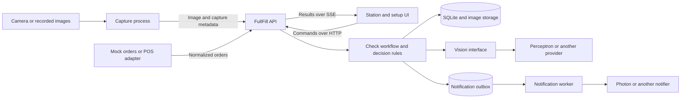

# FullFill system design proposal

Build FullFill as a modular Python backend, a separate camera process, and a React station UI in one repository. Keep external providers behind small interfaces owned by FullFill. This gives the group independent pieces to develop while keeping the first deployment small enough to run on one MacBook.

The product boundary is one order on a mat, one captured image, a comparison against a digital order and restaurant reference photos, and a recorded outcome. The useful requirements come from the [capture workflow, station states, and setup flow](../order-checker.md#4-design-set-out--snapshot--bag). The old assignments, event schedule, and sponsor choices do not determine component boundaries.

## Deployment and dependencies

Use React with TypeScript for the UI, FastAPI for the API and workflow, Python with OpenCV for capture, and SQLite plus a local image directory for persistence. Run one backend process with one managed check worker initially. Serve the built UI from the backend; a separate frontend development server is useful during development.

FastAPI supports composing routers from separate modules in one application, which fits these boundaries. The workflow and decision rules should remain callable without HTTP. [FastAPI application structure](https://fastapi.tiangolo.com/tutorial/bigger-applications/)



The boxes inside the backend are Python modules, not separate network services. Capture runs separately because camera access and frame processing have their own lifecycle. A Photon bridge becomes a separate TypeScript process only if its SDK requires it. The backend selects adapters in one composition module at startup.

## Component boundaries

| Component | Owns | Contract with the rest of the system | Development substitute |
| --- | --- | --- | --- |
| Station UI | Order queue, capture preview, results, setup forms, explicit overrides | HTTP commands and versioned station events | Recorded API responses and event stream |
| Capture process | Camera access, mat crop, stillness, QR decoding, image preparation | Uploads `Capture`; accepts snapshot requests | Recorded image sequence |
| Orders and catalog | Order revisions, item IDs, quantities, reference sets, external item mapping | `OrderSnapshot`, `ReferenceSet`, catalog commands | Seed menu and mock orders |
| Check workflow | Queuing, pinned inputs, timeouts, retries, durable results | `CheckRequest` to `CheckResult` | Fake vision and in-memory repositories |
| Decision rules | Quantity comparison, ambiguity handling, discrepancy classification | Pure function from order and observations to verdict | JSON fixtures |
| Vision adapter | Provider SDK, prompt, response parsing, image encoding, usage metadata | `VisionPort.inspect(input) -> Observations` | Deterministic fake provider |
| Notifications | Alert formatting, delivery attempts, delivery deduplication | `Notifier.send(notification)` | Recording or console notifier |
| Evaluation | Labeled cases, accuracy, latency, cost comparison | Same vision interface and decision function as the app | Saved responses |

Only the backend owns the database. Capture, UI, and notification bridges use the API; they do not import backend internals or query its tables. Business modules use explicit service methods rather than modifying each other's tables. Vendor SDK imports and vendor payloads stay inside their adapters.

## Contracts to agree on first

Define shared boundary models in a small Python contracts package, export JSON Schema and OpenAPI, and generate the TypeScript client/types. Maintain one source for wire schemas. Check generated schema changes in CI so independently written clients do not silently drift. Events and external HTTP payloads include `schema_version`; breaking changes require a new major version.

| Model | Essential fields and meaning |
| --- | --- |
| `OrderSnapshot` | Internal `order_id`, external source/key, `revision`, lines with stable `line_id`, `item_id`, quantity, and verification scope |
| `MenuItem` | Stable `item_id`, display name, label aliases, `verification_mode` such as visible item, label, or container count |
| `ReferenceSet` | `item_id`, immutable revision, image asset IDs, camera profile and notes about distinguishing features |
| `Capture` | `capture_id`, `station_id`, camera session, scene sequence, capture timestamp, image asset ID, QR candidate and binding method |
| `CheckRequest` | `check_id`, order revision, capture ID, pinned reference revisions, check generation, policy version |
| `Observations` | Item candidates, observed quantities or unknown, ambiguity reasons, visibility completeness, optional evidence/coordinates, unexpected objects, provider metadata |
| `CheckResult` | `check_id`, order revision, capture ID, verdict, line discrepancies, timestamps, latency, usage, model/prompt/policy versions |
| `Override` | Order revision, check ID, actor, reason, timestamp, explicit human disposition |
| `StationEvent` | Durable event ID, schema version, station/order/check IDs, event type, state revision, payload |

For example, an order for two ranch cups must carry `expected_quantity: 2`; a provider reporting one cup must not satisfy it with `present: true`. Require adapters to account for every requested line and reject malformed or contradictory output. Use stable IDs for matching. Unknown item identity stays unknown instead of being forced to the closest expected name.

The vision interface accepts a prepared image, candidate item descriptions, reference images, and verification scope. It returns evidence, never a final green/red UI state. The backend compares the evidence with the order. Optional grounding uses coordinates normalized to the stored, cropped image; adapters translate vendor coordinates. If grounding is unsupported, the checklist still works.

Perceptron is the initial adapter suggested by the plan. Its current quickstart documents image inputs, multiple assets, and JSON Schema output. Keep the exact model ID, request format, prompt, and parsing in that adapter and validate it with real order photos before treating accuracy or latency as established. [Perceptron quickstart](https://docs.perceptron.inc/perceptron-mk1.5/index)

## One check from capture to result

1. The worker lays out an order. Capture waits for a stable scene, reads the QR locally, crops the mat, and masks the ticket area before uploading an image. A dedicated ticket area makes masking predictable. If the order cannot be identified, the UI requests manual selection; the backend never guesses from queue position.
2. `POST /v1/captures` uploads image bytes and metadata and returns a capture ID. The backend resolves the QR token to an order. Treat QR contents as an opaque identifier, never a URL to fetch. For manual selection, record that binding explicitly.
3. `POST /v1/checks` references the capture and order revision with an idempotency key. In one database transaction, validate eligibility, pin the order/reference inputs, create a queued check, and assign the next check generation. Return `202` and `check_id` promptly.
4. A managed worker claims the job, prepares references only for relevant items, calls the vision adapter, and validates its output. Known confusing alternatives can be added later within an image/token budget. Keep quantity and identity ambiguity explicit.
5. The decision function computes discrepancies. Save every result for history. In the same transaction, update the disposition and create alert/event records only if the order revision, active check generation, and disposition revision still match. Stale results cannot trigger a new alert or overwrite a human action.
6. Publish the event to the UI, which shows the captured evidence alongside the outcome. The notification worker delivers alerts independently. Optional grounding can arrive later for visible unexpected or ambiguous objects; a genuinely missing item has no location to highlight.

The verdict applies to the captured arrangement. Bagging motion must not invalidate that evidence or start repeated checks. Show its timestamp and image, and keep unresolved orders visible after the mat clears. A recheck requires the relevant order to be laid out again.

For the first implementation, automatically check once per presentation and use an explicit Recheck action for corrections. Rearm automatic capture after the mat is cleared and a new presentation begins. Automatic correction detection can be added once it reliably distinguishes adding an item from bagging movements.

## State and failure rules

Keep execution status, machine verdict, and human disposition separate:

- Execution: `queued`, `running`, `completed`, `failed`, `superseded`.
- Machine verdict: `pass`, `fail`, `unsure`; absent if execution failed.
- Disposition: `pending`, `verified`, `needs_review`, `overridden`, `released`.

The UI uses green for a current pass, red for a definite discrepancy, amber for uncertain evidence, and an explicit unavailable/retry state for technical failure. An override records human acceptance and remains visibly distinct from machine verification. Release is an explicit action tied to the order revision; it may follow verification or a recorded override.

Accepting a recheck suspends any earlier verification while retaining unresolved discrepancies. An override closes the active check's authority to update the disposition. Release is terminal for that order revision; late results remain historical. Commands carry the expected disposition revision so conflicting actions are rejected rather than silently overwriting each other.

| Condition | Required behavior |
| --- | --- |
| All required visible or labeled evidence matches | Pass, within the declared verification scope |
| Complete, unambiguous view shows a quantity or identity mismatch | Fail and name the discrepancy |
| Occlusion, unreadable label, indistinguishable packaging, incomplete evidence | Unsure; request a clearer view or human check |
| Timeout, provider outage, invalid response, exhausted call budget | Failed execution; no pass |
| New check B finishes before check A | A remains in history but cannot overwrite B |
| Order changes while inference runs | Mark the old check superseded and require a check for the new revision |
| Failed/uncertain recheck follows a red result | Preserve the unresolved discrepancy until a valid correction check or explicit override |
| UI disconnects | Reconnect from the last event ID, or fetch a fresh station snapshot if replay is unavailable |
| Notification delivery fails | Keep the result; retry delivery separately |

Unknown quantities are not zero. A partly occluded image does not prove an item is missing. One visible object must not satisfy two distinct order lines; require unique evidence assignments where applicable and return unsure when matching overlaps. Numeric model confidence is diagnostic until calibrated against labeled examples.

For closed packaging, verify only visible container counts or label agreement. A matching label does not establish the contents or prove that a modifier was actually followed. The UI should name the scope, for example “labels and container counts matched.”

## API and local camera control

| Endpoint | Purpose |
| --- | --- |
| `GET /v1/orders` | Queue with revisions and current dispositions |
| `POST /v1/orders` | Create normalized mock/manual orders |
| `PATCH /v1/orders/{id}` | Update an order using its expected revision and invalidate earlier verification |
| `GET /v1/stations/{id}` | Authoritative station snapshot for first load and reconnect |
| `POST /v1/stations/{id}/capture-requests` | Request a check image or reference image |
| `GET /v1/stations/{id}/capture-requests` | Capture process polls for pending requests |
| `POST /v1/captures` | Upload an image, optionally completing a capture request |
| `POST /v1/checks` and `GET /v1/checks/{id}` | Start a check and inspect progress/result |
| `POST /v1/orders/{id}/overrides` | Record a reasoned human disposition |
| `POST /v1/orders/{id}/release` | Release the current verified or overridden revision |
| `GET/POST /v1/menu/items` | List or enroll items |
| `POST /v1/menu/items/{id}/references` | Create a new reference revision from an uploaded capture |
| `GET /v1/stations/{id}/events` | Server-sent events for state changes |

Use ordinary HTTP for commands and SSE for one-way updates; full bidirectional sockets are unnecessary for this first flow. A local low-resolution MJPEG preview can be served by the camera process through the backend, separately from result events. Do not send preview frames to the vision provider. Snapshot requests must return a newly captured frame with a request ID and timestamp, so setup never silently reuses an old preview.

## Persistence and operational limits

Start with tables for orders/lines, menu items/reference revisions, captures, checks/results, overrides, station events, and notification outbox entries. Put image bytes in a local directory behind an `AssetStore` interface; database rows hold IDs, hashes, and metadata. Keep immutable order/reference snapshots or revisions so a historical check can be explained after menu edits.

Persist jobs before acknowledging them. Use a single backend worker initially, claim jobs transactionally, and mark interrupted running checks and expired queued checks failed on restart; require a fresh recheck rather than silently approving old work. SQLite is the initial implementation behind repository interfaces. Moving to Postgres requires migrations and concurrency testing; the UI and vision contract stay stable.

Enforce a server-side concurrency limit, cooldown, per-order attempt limit, and persisted total-call budget. Reserve an attempt before each provider request, including retries and optional grounding. Apply a deadline; retry only appropriate transient failures within that budget. Ignore late completions after a check is superseded or timed out. Capture-side debouncing improves efficiency but never replaces backend limits.

Write alerts into an outbox in the result transaction. Deduplicate by order revision, discrepancy episode, and notification type, so repeated views of the same error do not text repeatedly. A new episode starts after resolution and a later recurrence. Use provider idempotency keys when supported. A provider accepting a message just before a crash can still cause a duplicate if it lacks idempotency; do not promise exactly-once delivery.

Bind local components to localhost initially and keep API credentials server-side. Before a remote station or public webhook is enabled, add station authentication, transport security, and webhook verification at that boundary. Crop/mask ticket details before external inference. Reference images may persist; check images should have a short configurable retention period, with sanitized evaluation captures retained only deliberately.

## Repository structure and independent work

```text
apps/
  web/                       # React UI and generated API client
  api/fullfill/
    http/                    # Routes, SSE, error translation
    application/             # Check orchestration and use cases
    domain/                  # Decision rules and state transitions
    ports/                   # Vision, repositories, assets, notifier interfaces
    adapters/
      vision/                # fake.py, perceptron.py, later providers
      orders/                # mock.py, later POS/webhook translation
      notifications/         # console.py, photon.py
      persistence/           # SQLite repositories and local assets
    bootstrap.py             # Adapter selection and dependency wiring
  capture/                   # OpenCV camera and image replay implementations
  photon_bridge/             # Optional, only if a TypeScript runtime is needed
packages/
  contracts/                 # Python wire models and generated schemas
fixtures/                    # Sanitized orders, images, observations, events
eval/                        # Dataset manifest and comparison runner
tests/                       # Contracts, decision rules, full workflow
docs/
  system-design.md
```

These are proposed folders, not an implemented scaffold. The group can choose ownership by component without carrying over the plan's named assignments. Useful independent work packages are UI/setup, camera/replay, core API/workflow, vision/evaluation, and optional notifications. For three people, combine adjacent packages according to interest; do not create a separate service merely to assign it to someone.

Each package should ship its contract examples and a runnable demonstration using fakes. The UI can consume fixture events, the workflow can use fake vision, and the vision/evaluation package can operate on saved captures. Integrations should require changes only to their adapter, configuration, and adapter-specific tests unless their capabilities change the product contract.

| Replacement | Expected change |
| --- | --- |
| Perceptron to another model | New vision adapter; rerun the same evaluation cases and capability checks |
| Continuity Camera to another camera or browser uploader | New capture implementation producing the same capture metadata |
| Mock orders to a POS | New ingress adapter, authenticated webhook handling, explicit external-to-internal item mapping and revision handling |
| Photon to another messenger | New notifier; preserve outbox and alert semantics |
| Local assets to object storage | New asset adapter and data migration |
| One station to several | Move persistence/coordination to a shared service, use durable worker claims and station-scoped events |

Adding reference images through messaging, if retained, should invoke the same catalog enrollment use case as the setup screen. It must not create a separate menu database or bypass image validation.

## Build order and validation

1. Agree on the wire contracts and fixtures: correct order, missing item, duplicate quantity, swapped lookalike, uncertain packaging, and provider failure. Establish schema generation before parallel implementation.
2. Connect the complete flow using an image replay source, mock orders, fake vision, and a recording notifier. Include SSE reconnect and an explicit recheck/override path.
3. Add real capture and the real vision adapter independently. Exercise them through the same contracts used by the fake flow.
4. Verify quantity handling, unknown evidence, out-of-order results, order edits, restart behavior, repeated triggers, and notification failure. Contract checks must run without live API keys.
5. Evaluate the actual provider on held-out photos and compare names-only against names-plus-reference-photos. Record end-to-end latency, false alarms, missed discrepancies, unsure rate, and usage. Reuse the plan's T1–T3 numbers as proposed acceptance targets, not measured guarantees. [Original test targets](../order-checker.md#passfail-tests-decide-by-about-3-pm)
6. Add Photon, optional grounding, and automatic correction checks after the core loop and recovery behavior work.

Start with the single-station deployment. Introduce a separate worker service or message broker when multiple stations, load, or restart requirements justify that operational cost; preserve the same job, observation, and result contracts.
