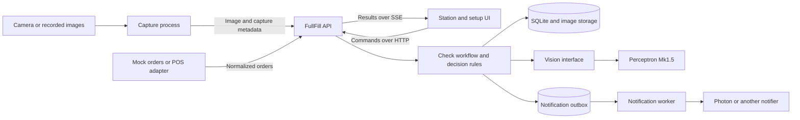

# FullFill system design proposal

Build FullFill as a modular Python backend, a separate camera process, and a React station UI in one repository. **Perceptron Mk1.5 is the selected vision provider for the MVP.** Keep its integration behind a small interface owned by FullFill. This gives the group independent pieces to develop while keeping the first deployment small enough to run on one MacBook.

The product boundary is one order on a mat, one captured image, a comparison against a digital order and restaurant reference photos, and a recorded outcome. The useful requirements come from the [capture workflow, station states, and setup flow](../order-checker.md#4-design-set-out--snapshot--bag). The old assignments, event schedule, and sponsor choices do not determine component boundaries.

## Deployment and dependencies

Use React with TypeScript for the UI, FastAPI for the API and workflow, Python with OpenCV for capture, and SQLite plus a local image directory for persistence. Run one backend process with one managed check worker initially. Serve the built UI from the backend; a separate frontend development server is useful during development.

FastAPI supports composing routers from separate modules in one application, which fits these boundaries. The workflow and decision rules should remain callable without HTTP. [FastAPI application structure](https://fastapi.tiangolo.com/tutorial/bigger-applications/)



The boxes inside the backend are Python modules, not separate network services. Capture runs separately because camera access and frame processing have their own lifecycle. A Photon bridge becomes a separate TypeScript process only if its SDK requires it. The backend selects adapters in one composition module at startup.

### Runtime lifecycle

The local deployment serves the built UI and API from `http://127.0.0.1:8000`. During development, a Vite frontend server proxies `/v1` requests and event streams to that API. The camera worker exposes its preview only on a configured loopback address; the backend proxies it through the station preview route. The browser has one application origin and never receives provider credentials. Vite produces the static frontend assets used by the local deployment. [Vite production build](https://vite.dev/guide/build)

`main.py` exposes an application factory. `bootstrap.py` constructs settings, repositories, the asset store, the Perceptron client, and application services. FastAPI's lifespan context starts and stops the check worker and notification worker, and closes database/network resources. A failed worker makes readiness fail until it is restarted or the application restarts. Run one API worker process initially; enabling multiple Uvicorn workers would otherwise duplicate the background loops. [FastAPI lifespan](https://fastapi.tiangolo.com/advanced/events/)

Use one long-lived `httpx.AsyncClient` inside the Perceptron adapter so inference requests do not block the API event loop. Run synchronous database transaction functions in a bounded thread pool, creating and closing their connections inside the same thread. OpenCV processing stays in the separate capture process. [HTTPX async client](https://www.python-httpx.org/async/)

On shutdown, stop accepting checks, finish or cancel active work within a bounded grace period, and release the camera. On startup, inspect persisted jobs before processing new ones: interrupted running work becomes a recorded technical failure; expired queued work fails; only fresh, still-current queued work may run. Liveness reports whether the process is running. Readiness reports database, asset-directory, configuration, and worker health without making a paid Perceptron request. Camera health is reported separately so a disconnected camera does not prevent reviewing existing orders.

## Component boundaries

| Component | Owns | Contract with the rest of the system | Development substitute |
| --- | --- | --- | --- |
| Station UI | Order queue, capture preview, results, setup forms, explicit overrides | HTTP commands and versioned station events | Recorded API responses and event stream |
| Capture process | Camera access, mat crop, stillness, QR decoding, image preparation | Uploads `Capture`; accepts snapshot requests | Recorded image sequence |
| Orders and catalog | Order revisions, item IDs, quantities, reference sets, external item mapping | `OrderSnapshot`, `ReferenceSet`, catalog commands | Seed menu and mock orders |
| Check workflow | Queuing, pinned inputs, timeouts, retries, durable results | `CreateCheckRequest` to `CheckResult` | Fake vision and in-memory repositories |
| Decision rules | Quantity comparison, ambiguity handling, discrepancy classification | Pure function from order and observations to verdict | JSON fixtures |
| Vision adapter | Provider SDK, prompt, response parsing, image encoding, usage metadata | `VisionProvider.inspect(input) -> Observations` | Deterministic fake provider |
| Notifications | Alert formatting, delivery attempts, delivery deduplication | `Notifier.send(notification)` | Recording or console notifier |
| Evaluation | Labeled cases, accuracy, latency, cost comparison | Same vision interface and decision function as the app | Saved responses |

Only the backend owns the database. Capture, UI, and notification bridges use the API; they do not import backend internals or query its tables. Business modules use explicit service methods rather than modifying each other's tables. Vendor SDK imports and vendor payloads stay inside their adapters.

## Contracts to agree on first

Define shared boundary models with Pydantic v2 in a small Python contracts package, export JSON Schema and OpenAPI, and generate the TypeScript client/types. Pydantic models can generate JSON Schema for these boundaries. The event models need an explicit schema export as well because an SSE route does not describe each event payload in OpenAPI. Maintain one source for wire schemas and check generated changes in CI. Version JSON bodies and events with `schema_version`; GET routes use the `/v1` path. Breaking changes require a new major version. [Pydantic JSON Schema](https://docs.pydantic.dev/latest/concepts/json_schema/)

| Model | Essential fields and meaning |
| --- | --- |
| `OrderSnapshot` | Internal `order_id`, external source/key, `revision`, lines with stable `line_id`, `item_id`, quantity, and verification scope |
| `MenuItem` | Stable `item_id`, display name, label aliases, `verification_mode` such as visible item, label, or container count |
| `ReferenceSet` | `item_id`, immutable revision, image asset IDs, camera profile and notes about distinguishing features |
| `Capture` | `capture_id`, `station_id`, camera session, scene sequence, capture timestamp, image asset ID, QR candidate and binding method |
| `CreateCheckRequest` | Client-supplied station ID, order ID/revision, expected disposition revision, capture ID |
| `CheckSpec` | Server-created `check_id`, pinned order/reference revisions, capture ID, generation, disposition guard, policy/prompt versions, deadline |
| `VisionInput` | Prepared image, verification targets, pinned reference images, verification scope; excludes provider credentials |
| `Observations` | Item candidates, observed quantities or unknown, ambiguity reasons, visibility completeness, optional evidence/coordinates, unexpected objects, provider metadata |
| `CheckResult` | `check_id`, order revision, capture ID, verdict, line discrepancies, timestamps, latency, usage, model/prompt/policy versions |
| `Override` | Order revision, check ID, actor, reason, timestamp, explicit human disposition |
| `StationEvent` | Durable event ID, schema version, station/order/check IDs, event type, state revision, payload |

For example, an order for two ranch cups must carry `expected_quantity: 2`; a provider reporting one cup must not satisfy it with `present: true`. Before inference, group identical order lines into verification targets by item, label/variant, and verification mode, preserving their source line IDs. Require adapters to account for every target and reject malformed or contradictory output. Use stable IDs for matching. Unknown item identity stays unknown instead of being forced to the closest expected name.

The vision interface accepts a prepared image, candidate item descriptions, reference images, and verification scope. It returns evidence, never a final green/red UI state. The backend compares the evidence with the order. Optional grounding uses coordinates normalized to the stored, cropped image; adapters translate vendor coordinates. If grounding is unsupported, the checklist still works.

Perceptron is the MVP adapter. Its quickstart documents image inputs, multiple assets, and JSON Schema output. Keep the exact model ID, request format, prompt, and parsing in that adapter and validate it with real order photos before treating accuracy or latency as established. `FakeVision` is an explicitly selected development substitute, never an automatic fallback after a real provider failure. [Perceptron quickstart](https://docs.perceptron.inc/perceptron-mk1.5/index)

### Example data crossing the boundaries

IDs below are illustrative. Production IDs are opaque strings; timestamps use UTC with a timezone. Counts are non-negative integers, expected quantities are positive, and unknown observed quantities use `null`. Clients cannot set the server's check generation, pinned references, or final verdict.

A UI or camera workflow submits the following JSON to `POST /v1/checks`, with a unique `Idempotency-Key` header:

```json
{
  "schema_version": 1,
  "station_id": "station_1",
  "order_id": "order_4127",
  "order_revision": 3,
  "expected_disposition_revision": 5,
  "capture_id": "capture_17"
}
```

The API responds with `202`, a check ID, execution status, and the newly accepted disposition revision. The backend prepares a target for two ranch cups; expected quantities remain in its decision input. The adapter's normalized observation could be:

```json
{
  "schema_version": 1,
  "capture_id": "capture_17",
  "targets": [
    {
      "target_id": "target_ranch",
      "observed_quantity": 1,
      "identity": "matched",
      "visibility_complete": true,
      "evidence_ids": ["object_1"],
      "uncertainty_reason": null
    }
  ],
  "unexpected_objects": [],
  "scene_complete": true
}
```

Here `visibility_complete` means the full target group can be counted without unresolved occlusion; `scene_complete` means the remaining scene has been inspected for unexplained objects. These are model judgments that must be evaluated, not guarantees. Evidence IDs refer only to objects in the captured order image, never the reference images. If a count cannot be established, return `null` with a reason. The adapter attaches trusted capture IDs and provider metadata itself rather than accepting identifiers invented by the model.

The resulting UI payload, emitted inside a station event, could be:

```json
{
  "schema_version": 1,
  "check_id": "check_23",
  "capture_id": "capture_17",
  "order_id": "order_4127",
  "order_revision": 3,
  "execution_status": "completed",
  "verdict": "fail",
  "disposition": "needs_review",
  "disposition_revision": 7,
  "discrepancies": [
    {
      "target_id": "target_ranch",
      "line_ids": ["line_2"],
      "kind": "missing",
      "expected_quantity": 2,
      "observed_quantity": 1,
      "missing_quantity": 1
    }
  ]
}
```

The example assumes acceptance advanced disposition revision 5 to 6 and completion advanced it to 7. Result text such as “Missing: one ranch cup” is derived from these structured fields and catalog names, so the UI does not parse a model's prose.

## Interface implementations

Separate interfaces at two levels: HTTP between running apps, and typed Python calls inside the backend. An interface defines the accepted inputs and outputs; an adapter implements that agreement for a particular provider. The backend owns these interfaces so replacing a vendor does not redefine the application's data model.

| Backend interface | Input and output | Implementation examples |
| --- | --- | --- |
| `OrderRepository.get(order_id)` | Order ID to an order snapshot or not-found result | SQLite, in-memory fixture store |
| `Catalog.get_references(item_ids)` | Item IDs to descriptions and immutable reference sets | Local catalog with seeded or enrolled items |
| `VisionProvider.inspect(request)` | Prepared image, candidates, and references to observations | Perceptron, another model, deterministic fake |
| `CheckRepository.save(result)` | Check result to persisted history | SQLite, in-memory fixture store |
| `Notifier.send(notification)` | Normalized alert to delivery result | Photon, another messenger, recording notifier |

Repository writes participate in the workflow's transaction; saving a result, updating eligible order state, and inserting events/outbox entries follow the atomic completion rule below. POS integrations normalize incoming orders through the order application service; storage repositories do not call POS APIs.

For example, the Python vision interface would be:

```python
from __future__ import annotations
from typing import Protocol


class VisionProvider(Protocol):
    async def inspect(self, request: VisionInput) -> Observations:
        ...
```

`VisionInput` and `Observations` are FullFill-owned types. Implement `PerceptronVision` and `FakeVision` against the same method; any future provider must satisfy that contract. The startup module selects an implementation and passes it into the check workflow. The workflow calls `vision.inspect(request)`, then passes the returned observations to `compare_order(order, observations)`; provider HTTP calls and response parsing remain inside the adapter. The notification worker separately receives a `Notifier` implementation.

Define the interfaces in `ports/`, shared boundary schemas in `packages/contracts/`, and concrete implementations in `adapters/`. Decision rules depend only on domain data. Application code depends on the interfaces; only `bootstrap.py` wires concrete adapters into the application. This keeps vendor-specific imports out of routes, decision rules, and UI code.

For independent development, each interface needs a fake implementation or example payloads covering success, uncertainty, and failure. The UI developer can replay result events while the vision developer runs saved images through the real adapter. Both validate their outputs against the same schemas.

## Perceptron request and validation

Implement `PerceptronVision` with an async HTTP request to `https://api.perceptron.inc/v1/chat/completions`, model `perceptron-mk1.5`, and a server-side bearer API key. The provider uses chat-completion messages containing text and image inputs. [Perceptron request example](https://docs.perceptron.inc/perceptron-mk1.5/index)

The adapter builds a fresh request for each check:

1. Put the captured order image first and identify it as the only image whose objects should be counted.
2. Add each target's stable ID, name, label aliases, verification scope, and labeled reference images. References illustrate appearance and must not count toward observed quantities. Keep expected quantities in the backend comparison input to reduce pressure to confirm an expected answer.
3. Ask for counts, identity ambiguity, visibility, unexplained objects, and evidence IDs using a compact `VisionEvidence` schema. Request no tool calls or final pass/fail judgment.
4. Request JSON Schema output with `response_format.type = "json_schema"`, a named schema, and `strict: true`. Use `max_completion_tokens` as a configurable output budget. Accept only a completed answer with `finish_reason = "stop"`, no tool calls, and JSON that validates locally. A syntactically valid answer still needs semantic validation. [Perceptron structured output](https://docs.perceptron.inc/perceptron-mk1.5/capabilities/structured-outputs)

`VisionEvidence` contains only model-produced fields. The adapter converts it into `Observations` by attaching the trusted capture ID, provider/model identity, prompt version, request ID when supplied, token usage, and elapsed time. Check that target IDs match the requested set exactly, counts agree with evidence assignments, and an object is not reused across distinct targets. Duplicate target IDs, unknown target IDs, malformed counts, and truncated output are invalid responses. Genuine visual ambiguity becomes a valid `unsure` observation.

Keep the prompt in a versioned text file beside the adapter and record its hash with the check. Bound both the number and bytes of reference images. If an order exceeds the configured input budget, return an explicit unsupported-input result instead of silently dropping targets. Start with one primary reference per target; select additional views only within that budget. Keep grounding optional and lower priority than the first result.

Map provider failures to typed application errors: `ProviderUnavailable`, `ProviderRateLimited`, `ProviderTimeout`, `InvalidVisionResponse`, and `InputBudgetExceeded`. Retry transient transport failures, rate limits, or server errors only when the remaining deadline and call budget allow it; respect `Retry-After`. Authentication failures and invalid structured output need correction, not an unbounded retry loop. Every network attempt consumes a reserved application call-budget slot, even if its eventual provider billing is unknown. Cancellation cannot guarantee that a request already received by Perceptron stops processing or billing.

## One check from capture to result

1. The worker lays out an order. Capture waits for a stable scene, reads the QR locally, crops the mat, and masks the ticket area before uploading an image. A dedicated ticket area makes masking predictable. If the order cannot be identified, the UI requests manual selection; the backend never guesses from queue position.
2. `POST /v1/captures` uploads image bytes and metadata and returns a capture ID plus any resolved order context. The backend resolves the QR token to an order. Treat QR contents as an opaque identifier, never a URL to fetch. For manual selection, record that binding explicitly.
3. `POST /v1/checks` references the capture and order revision with an idempotency key. In one database transaction, validate eligibility, pin the order/reference inputs, create a queued check, and assign the next check generation. Return `202` and `check_id` promptly.
4. A managed worker claims the job, prepares references only for relevant items, calls the vision adapter, and validates its output. Known confusing alternatives can be added later within an image/token budget. Keep quantity and identity ambiguity explicit.
5. The decision function computes discrepancies. Save every result for history. In the same transaction, update the disposition and create alert/event records only if the order revision, active check generation, and disposition revision still match. Stale results cannot trigger a new alert or overwrite a human action.
6. Publish the event to the UI, which shows the captured evidence alongside the outcome. The notification worker delivers alerts independently. Optional grounding can arrive later for visible unexpected or ambiguous objects; a genuinely missing item has no location to highlight.

The verdict applies to the captured arrangement. Bagging motion must not invalidate that evidence or start repeated checks. Show its timestamp and image, and keep unresolved orders visible after the mat clears. A recheck requires the relevant order to be laid out again.

For the first implementation, automatically check once per presentation and use an explicit Recheck action for corrections. Rearm automatic capture after the mat is cleared and a new presentation begins. Automatic correction detection can be added once it reliably distinguishes adding an item from bagging movements.

For an automatic order capture, the camera process submits `/v1/checks` using the order context returned by the upload API. It does not reconstruct order contents. Unknown QR values remain unbound until the UI supplies a manual selection. Reference captures carry `purpose: "reference"` and never automatically start checks. A check request referencing the same capture and order revision is deduplicated even if the UI and camera submit it concurrently.

## State and failure rules

Keep execution status, machine verdict, and human disposition separate:

- Execution: `queued`, `running`, `completed`, `failed`, `superseded`.
- Machine verdict: `pass`, `fail`, `unsure`; absent if execution failed.
- Disposition: `pending`, `verified`, `needs_review`, `overridden`, `released`.

The UI uses green for a current pass, red for a definite discrepancy, amber for uncertain evidence, and an explicit unavailable/retry state for technical failure. An override records human acceptance and remains visibly distinct from machine verification. Release is an explicit action tied to the order revision; it may follow verification or a recorded override.

Accepting a recheck suspends any earlier verification while retaining unresolved discrepancies. An override closes the active check's authority to update the disposition. Release is terminal for that order revision; late results remain historical. Commands carry the expected disposition revision so conflicting actions are rejected rather than silently overwriting each other.

| Condition | Required behavior |
| --- | --- |
| All required visible or labeled evidence matches | Pass, within the declared verification scope |
| Complete, unambiguous view shows a quantity or identity mismatch | Fail and name the discrepancy |
| Occlusion, unreadable label, indistinguishable packaging, incomplete evidence | Unsure; request a clearer view or human check |
| Timeout, provider outage, invalid response, exhausted call budget | Failed execution; no pass |
| New check B finishes before check A | A remains in history but cannot overwrite B |
| Order changes while inference runs | Mark the old check superseded and require a check for the new revision |
| Failed/uncertain recheck follows a red result | Preserve the unresolved discrepancy until a valid correction check or explicit override |
| UI disconnects | Reconnect from the last event ID, or fetch a fresh station snapshot if replay is unavailable |
| Notification delivery fails | Keep the result; retry delivery separately |

Unknown quantities are not zero. A partly occluded image does not prove an item is missing. One visible object must not satisfy two distinct verification targets or be counted twice within a target; require unique evidence assignments and return unsure when matching overlaps. Numeric model confidence is diagnostic until calibrated against labeled examples.

For closed packaging, verify only visible container counts or label agreement. A matching label does not establish the contents or prove that a modifier was actually followed. The UI should name the scope, for example “labels and container counts matched.”

The comparison function first validates that all target observations are available. It then reports definite mismatches, otherwise uncertainty, otherwise pass. A definite mismatch plus an uncertain target remains fail, with both explanations preserved. Confirmed excess objects are discrepancies; unexplained objects of uncertain relevance make the result unsure. A pass requires exact counts, adequate identity evidence, complete relevant visibility, and no unresolved extra objects. Label-only targets use label agreement as their declared scope.

Only a completed current pass can set `verified`. Accepting another check makes that verification pending; a failure cannot restore it. An order update increments its content revision and invalidates previous verification. Release is terminal: changes received after release are flagged for explicit handling instead of silently reopening or rewriting the released order.

## API and local camera control

The UI and camera process use HTTP commands with JSON metadata; capture uploads use multipart requests containing the image file and metadata. Commands return IDs or normalized FullFill responses. Server-sent events carry JSON state updates to the UI. Vendor payloads never cross these boundaries.

| Endpoint | Purpose |
| --- | --- |
| `GET /v1/orders` | Queue with revisions and current dispositions |
| `POST /v1/orders` | Create normalized mock/manual orders |
| `PATCH /v1/orders/{id}` | Update an order using its expected revision and invalidate earlier verification |
| `GET /v1/stations/{id}` | Authoritative station snapshot for first load and reconnect |
| `POST /v1/stations/{id}/sessions` and `POST /v1/stations/{id}/heartbeat` | Register the active capture session and report camera health |
| `POST /v1/stations/{id}/capture-requests` | Request a check image or reference image |
| `GET /v1/stations/{id}/capture-requests` | Capture process polls for pending requests |
| `POST /v1/captures` | Upload an image, optionally completing a capture request |
| `POST /v1/checks` and `GET /v1/checks/{id}` | Start a check and inspect progress/result |
| `POST /v1/orders/{id}/overrides` | Record a reasoned human disposition |
| `POST /v1/orders/{id}/release` | Release the current verified or overridden revision |
| `GET/POST /v1/menu/items` | List or enroll items |
| `POST /v1/menu/items/{id}/references` | Create a new reference revision from an uploaded capture |
| `GET /v1/stations/{id}/events` | Server-sent events for state changes |
| `GET /v1/stations/{id}/preview` | Proxy the configured local camera preview |
| `GET /v1/assets/{id}` | Serve an allowed stored capture/reference by asset ID |
| `GET /health/live` and `GET /health/ready` | Process liveness and application readiness |

Use ordinary HTTP for commands and SSE for one-way updates; full bidirectional sockets are unnecessary for this first flow. A local low-resolution MJPEG preview can be served by the camera process through the backend, separately from result events. Do not send preview frames to the vision provider. Snapshot requests must return a newly captured frame with a request ID and timestamp, so setup never silently reuses an old preview.

### HTTP behavior and events

Capture uploads contain multipart fields `image` and `metadata`, where metadata is serialized JSON. Validate the decoded image format, dimensions, byte limit, station session, capture purpose, and timestamp before accepting it. Generate asset paths on the server, strip image metadata, and store the server-computed hash. A camera session uses increasing scene sequence numbers; `(station_id, session_id, scene_sequence)` uniquely identifies an automatic capture. A manual capture request can be fulfilled only once.

Mutation requests carry an `Idempotency-Key`. Persist its operation scope, normalized request hash, and response in the same transaction as the mutation. Repeating the same key and body returns the recorded response; reusing a key with different input returns `409`. A unique check constraint on station, capture, order ID, and order revision also prevents accidental repeat inference under different keys. A capture's order/revision binding becomes immutable when resolved or manually assigned; attempting to reuse it for another order or a later revision returns `409`. Rechecks use fresh captures. Retries never create a second accepted check.

Use `404` for unknown resources, `409` for stale revisions or conflicting commands, `413` for oversized images, `422` for invalid payloads, and `429` for admission limits. A provider outage after `202` is represented by the check's failed execution status, not a retroactive HTTP error. Error bodies contain `schema_version`, a stable `code`, a readable `message`, `request_id`, and optional field details; omit secrets and raw provider bodies.

Each SSE record has a durable `id`, an event type such as `check.queued`, `check.completed`, `check.failed`, or `order.updated`, and a versioned JSON envelope. The station snapshot returns both its current state and an event cursor from the same database read snapshot. The UI opens the stream after that cursor, deduplicates event IDs, and applies only newer revisions for each order. Reconnect using `Last-Event-ID`; if history has expired, send a resync event and fetch a fresh snapshot. Heartbeats detect disconnection, and polling the station snapshot is a fallback. Persisted events are authoritative, so losing an in-memory wakeup cannot lose a result.

### Camera and frontend behavior

The capture loop has `waiting`, `stabilizing`, `submitted`, and `disconnected` states. Compare downsampled grayscale frames inside the calibrated mat area, require low motion for a configurable interval, and reject blurred or unreadable frames. Stillness is a trigger heuristic, not proof that an image is sharp or that hands have left. After submission, ignore ordinary bagging motion until an empty-mat interval rearms the station, or an explicit capture request arrives.

Store the mat crop, ticket mask, camera identifier, orientation, and calibration revision as a camera profile. Attach that revision to captures and references. If calibration changes, mark references for review or recapture. Reference mode pauses automatic checking so photographing a new item cannot accidentally create an order result. If the camera disconnects, clear its last-frame buffer, report stale preview status, and require a new frame after reconnection.

The React app has separate station, queue, and catalog/setup features. Keep API calls in the generated client, SSE handling in one station-event hook, and rendering in components. The backend is the authority for verdicts and release eligibility; the frontend never optimistically marks a check passed. Display the evidence snapshot separately from the live preview so a result arriving after bagging is clearly tied to what was photographed. Override and release commands include the expected disposition revision and handle `409` by refreshing the order.

## Persistence and operational limits

Start with tables for orders/lines, menu items/reference revisions, captures, checks/results, overrides, station events, and notification outbox entries. Put image bytes in a local directory behind an `AssetStore` interface; database rows hold IDs, hashes, and metadata. Keep immutable order/reference snapshots or revisions so a historical check can be explained after menu edits.

### Initial database schema

The MVP database belongs to one restaurant. Keep database row models inside the persistence adapter; HTTP responses use explicit contract models rather than exposing database rows.

| Table or group | Important columns and constraints |
| --- | --- |
| `stations` | Station ID, active capture session, camera profile revision, last heartbeat |
| `orders` | Order ID, source/external key, current order revision, disposition revision, active check ID/generation, disposition; unique source/external key |
| `order_versions`, `order_lines` | Immutable order snapshots and line quantities; keys include order ID and revision |
| `menu_items`, `reference_sets`, `reference_images` | Stable item IDs, immutable reference revisions, verification mode, camera profile, ordered asset links |
| `assets` | Asset ID, relative storage key, content hash, MIME type, size, dimensions, purpose, expiry |
| `capture_requests`, `captures` | Request/session IDs, sequence, purpose, image asset, timestamps, resolved order binding; unique fulfilled request and capture sequence |
| `checks`, `check_results` | Frozen check specification, execution status, deadline, generation/guards, normalized observations, verdict, timing and provider metadata |
| `provider_attempts` | Check ID, attempt number, reserved/start/end times, outcome, reported usage; unique check/attempt pair |
| `idempotency_records` | Station/operation/key, request hash, response status/body; unique scoped key |
| `overrides` | Order revision, check ID, actor, reason, creation time |
| `station_events` | Increasing event ID, station/order IDs, scoped state revision, type, versioned JSON payload |
| `notification_outbox` | Unique alert deduplication key, payload, delivery state, attempts, next retry time, provider receipt when available |

Enable foreign-key enforcement per connection, use WAL on the local disk, and keep write transactions short with a bounded busy timeout. SQLite permits only one writer at a time, so no database transaction may span a Perceptron or messaging request. Implement ordered SQL migrations with a schema-version table; startup checks the version and the launcher runs migrations before starting workers. [SQLite isolation](https://www.sqlite.org/isolation.html)

### Check transactions

1. **Accept:** in a short write transaction, first return any matching idempotent response or already-accepted capture/order check. Only new commands proceed to capture age/session/binding checks, expected-revision checks, and admission limits. Pin the order/references/policy, increment the generation and disposition revision, insert the queued check and event, and store the command response. This ordering lets a retry retrieve its original response even though acceptance changed the order's state revision. A new queued check may supersede older queued work for the same order; a released order cannot accept a new check.
2. **Claim and attempt:** atomically claim a queued, unexpired check and reserve a provider-attempt budget slot. Commit before loading/encoding images or awaiting Perceptron. Recheck eligibility immediately before dispatch. For the MVP, one global inference slot bounds concurrency; optional grounding uses the same limiter.
3. **Complete:** persist the result and attempt outcome, then compare the order revision, active check ID/generation, and disposition guard in the same write transaction. If they still match, apply the transition and append station events/outbox entries. Otherwise retain the result as superseded history. Technical failures use the same guard and preserve any unresolved discrepancy.

The storage interface also exposes a unit of work that groups repository writes into one transaction. Application services own transaction boundaries; repositories never independently commit pieces of a check completion. Tests should exercise competing check, override, and order-update commands against a real temporary SQLite database.

Write images to a temporary file, validate them, and atomically rename them before committing an asset row. A database failure can leave an unreferenced file, which a cleanup job removes later. Never commit an asset row pointing to a partially written file. Retention deletes expired image bytes only when no queued/running job or live reference set needs them; retain result metadata and show an expired-image placeholder for old checks.

Persist jobs before acknowledging them. Use a single backend worker initially, claim jobs transactionally, and mark interrupted running checks and expired queued checks failed on restart; require a fresh recheck rather than silently approving old work. SQLite is the initial implementation behind repository interfaces. Moving to Postgres requires migrations and concurrency testing; the UI and vision contract stay stable.

Enforce a server-side concurrency limit, cooldown, per-order attempt limit, and persisted total-call budget. Reserve an attempt before each provider request, including retries and optional grounding. Apply a deadline; retry only appropriate transient failures within that budget. Ignore late completions after a check is superseded or timed out. Capture-side debouncing improves efficiency but never replaces backend limits.

Write alerts into an outbox in the result transaction. Deduplicate by order revision, discrepancy episode, and notification type, so repeated views of the same error do not text repeatedly. A new episode starts after resolution and a later recurrence. Use provider idempotency keys when supported. A provider accepting a message just before a crash can still cause a duplicate if it lacks idempotency; do not promise exactly-once delivery.

Bind local components to localhost initially and keep API credentials server-side. Before a remote station or public webhook is enabled, add station authentication, transport security, and webhook verification at that boundary. Crop/mask ticket details before external inference. Reference images may persist; check images should have a short configurable retention period, with sanitized evaluation captures retained only deliberately.

## Repository structure and independent work

For three people, split ownership by component so each person mostly edits separate files. A, B, and C are proposed work areas the team can assign according to interest.

| Person | Owns | First deliverable |
| --- | --- | --- |
| A — Frontend | Station screen, order checklist, setup/reference-photo screens, API client | A working screen using fake orders and results |
| B — Backend | API routes, orders/menu storage, check workflow, decision rules, result events | A complete check using a fake vision provider |
| C — Camera and vision | Camera capture, QR decoding, image preparation, vision adapter, accuracy evaluation | A saved photo producing validated observations, followed by live capture |

```text
pyproject.toml               # B: Python workspace and shared tool settings
uv.lock                      # B: Locked Python workspace dependencies
Makefile                     # B: Shared setup, dev, test, build, serve tasks
.env.example                 # B: Documented settings, no real credentials
.gitignore                   # B: Exclude secrets, local assets, DBs, build output
.github/workflows/ci.yml     # B coordinates; A/C contribute their checks
apps/
  web/                       # A
    package.json
    package-lock.json
    vite.config.ts
    src/
      api/generated/         # Generated types/client; never hand-edit
      api/station-events.ts  # SSE replay, reconnect, and polling fallback
      features/station/      # Preview, checklist, check/override/release controls
      features/catalog/      # Item enrollment and reference capture
      features/orders/       # Queue and order details
      mocks/                 # Fixture HTTP responses and event streams
  api/
    pyproject.toml
    fullfill/
      main.py                # B: Application factory and lifespan
      settings.py            # B: Validated configuration
      bootstrap.py           # B: Concrete adapter wiring
      http/                  # B
        orders.py
        catalog.py
        captures.py
        checks.py
        stations.py          # Sessions, heartbeat, snapshot, preview
        events.py
        health.py
      application/           # B
        submit_capture.py
        start_check.py
        check_worker.py
        complete_check.py
        enroll_item.py
        notification_worker.py
      domain/                # B: Pure rules, no HTTP or vendor imports
        verification_targets.py
        compare_order.py
        transitions.py
      ports/                 # B maintains; agree with consumers
        vision.py
        repositories.py
        unit_of_work.py
        assets.py
        notifier.py
      adapters/
        vision/              # C
          fake.py
          perceptron.py
          prompt_v1.txt
          response_validation.py
        orders/              # B: Mock orders and later POS translation
        notifications/       # B: Recording notifier, later Photon
        persistence/         # B
          sqlite.py
          repositories.py
          local_assets.py
    migrations/              # B: Ordered SQL migrations
  capture/                   # C
    pyproject.toml
    fullfill_capture/
      __main__.py
      sources.py             # OpenCV and recorded-image implementations
      trigger.py
      prepare_image.py       # Crop, mask, orientation, resize
      qr.py
      backend_client.py
      preview.py
  photon_bridge/             # B: Optional TypeScript bridge
packages/
  contracts/                 # Agree together; B maintains
    pyproject.toml
    fullfill_contracts/
      orders.py
      catalog.py
      captures.py
      checks.py
      vision.py
      events.py
      errors.py
    generated/               # Committed OpenAPI and event JSON Schema
scripts/                     # B coordinates
  dev.py                     # Start/stop local processes and wait for health
  export_contracts.py
  seed_demo.py
fixtures/                    # Everyone: Sanitized examples
  orders/
  images/
  observations/
  events/
eval/                        # C
  manifest.jsonl             # Cases, labels, splits, reference-set versions
  run.py
tests/
  domain/                    # B
  api/                       # B
  persistence/               # B
  capture/                   # C
  vision/                    # C
  contracts/                 # All consumers
  integration/               # B coordinates with A/C
data/                        # Local runtime directory; ignored by Git
docs/
  system-design.md
```

These are proposed folders, not an implemented scaffold. With a fourth person, split camera capture from vision/evaluation into separate work areas. Component ownership does not require a separate server for each person.

Before splitting up, agree on four contracts together: the camera upload, the order with quantities, the vision observations, and the result sent to the UI. Save example payloads alongside their schemas. B maintains the shared definitions; changes affecting another component are discussed with its owner before merging.

Each work area should ship a runnable demonstration using fakes. A uses sample API responses and events without waiting for the backend. B uses fake observations without waiting for the real vision provider. C uses saved images without waiting for the UI or live camera. All three validate against the same contracts.

Use one component branch per work area and small pull requests into `main`. Component owners review changes touching their areas; shared contract changes also need review from the affected consumers. Include matching schema, fixture, and client updates when a contract changes. Each contributor adds meaningful tests for their component, while B coordinates the initial complete workflow and shared checks.

Integrate early with image replay, fake vision, the backend, and the UI. Replace replay and fake vision with real capture and inference independently, keeping the complete flow working after each merge. B coordinates the initial integration, and each owner remains responsible for their component working through the agreed interface.

Integrations should require changes only to their adapter, configuration, and adapter-specific tests unless their capabilities change the product contract.

| Replacement | Expected change |
| --- | --- |
| Perceptron to another model | New vision adapter; rerun the same evaluation cases and capability checks |
| Continuity Camera to another camera or browser uploader | New capture implementation producing the same capture metadata |
| Mock orders to a POS | New ingress adapter, authenticated webhook handling, explicit external-to-internal item mapping and revision handling |
| Photon to another messenger | New notifier; preserve outbox and alert semantics |
| Local assets to object storage | New asset adapter and data migration |
| One station to several | Move persistence/coordination to a shared service, use durable worker claims and station-scoped events |

Adding reference images through messaging, if retained, should invoke the same catalog enrollment use case as the setup screen. It must not create a separate menu database or bypass image validation.

### Scaffold commands and configuration

The tree and commands in this section are implementation targets, not files or commands already created by this documentation change. Use a root Python workspace with separate API, capture, and contracts packages; API and capture depend on contracts, while contracts depends on no application package. Lock Python dependencies in `uv.lock` and frontend dependencies in `package-lock.json`. The capture environment should not need the Perceptron integration to run.

| Proposed command | Behavior once implemented |
| --- | --- |
| `make setup` | Install locked dependencies, create local data directories, and apply migrations |
| `make contracts` | Export OpenAPI/event schemas and regenerate the TypeScript client/types |
| `make dev` | Start Vite, API with `FakeVision`, replay capture, and recording notifier; label the mode clearly |
| `make dev-live` | Start the same flow with the real camera and Perceptron; fail configuration checks if the key is missing |
| `make seed` | Idempotently add demo menu/orders from fixtures without overwriting enrolled items |
| `make test` | Run local checks with fake providers; require no credentials or paid calls |
| `make build` | Type-check and build the frontend assets for the backend to serve |
| `make serve` | Apply migrations, launch the built local app and configured camera source, and wait for readiness |
| `make eval` | Explicitly run the selected labeled dataset against Perceptron within a separate configured budget |

The launcher waits for backend readiness before starting capture, forwards shutdown signals to its child processes, and reports which component failed. Reload is a development feature; the built local app runs one backend process without reload. Log the selected provider and capture source at startup so a fake result cannot be mistaken for live inference.

| Setting | Proposed initial value or rule |
| --- | --- |
| `FF_VISION_PROVIDER` | `perceptron`; `make dev` explicitly selects `fake` |
| `PERCEPTRON_API_KEY` | Required only for real inference; backend environment only |
| `FF_PERCEPTRON_MODEL` | `perceptron-mk1.5` |
| `FF_CAPTURE_SOURCE` | `opencv` for the station, `replay` for development |
| `FF_STATION_ID` | Stable station ID reused across restarts |
| `FF_DATA_DIR` | `./data`; holds SQLite and image assets |
| `FF_STILLNESS_MS` | Start at 500 ms and tune using capture fixtures |
| `FF_CAPTURE_MAX_AGE_SECONDS` | Start at 30 seconds for admitting/dispatching checks |
| `FF_CHECK_TIMEOUT_SECONDS` | Start at 12 seconds end to end; tune from measured latency |
| `FF_MAX_PROVIDER_ATTEMPTS` | At most 2 per check, subject to deadline and budget |
| `FF_MAX_PROVIDER_CALLS` | Initial hard cap of 250 attempts in a persisted budget allocation |
| `FF_MAX_COMPLETION_TOKENS` | Start at 1024; measure output sizes before reducing |

These values are application defaults to test, not provider guarantees. Restarting the app does not reset its persisted call counter; increasing/resetting a budget is an explicit operator action. Configure image limits, reference count/byte budgets, cooldown, and retention in the same settings module. Keep real `.env` files, runtime data, and credentials out of Git; share only `.env.example` and sanitized fixtures.

### Scaffold completion criteria

The first scaffold is complete when a fresh checkout can start in fake mode, show a seeded order, accept a replay capture, display a persisted result, reconnect the UI without losing it, and stop all processes cleanly. The same workflow must accept the real Perceptron adapter through configuration without changing route or UI code. Enrolling an item must create a new reference revision that the next check can use without restarting the backend.

CI should regenerate contracts and fail on drift; run Python formatting/linting, domain/API/persistence/capture/vision tests, frontend type checks and component tests, and a frontend build. Use recorded HTTP responses to test provider parsing without spending credits. Live accuracy evaluation is an explicit separate task with a fixed manifest, prompt/reference versions, and call budget.

| Acceptance case | Behavior to verify |
| --- | --- |
| Two expected cups, one clearly visible | Fail with a missing quantity of one |
| Occluded target or indistinguishable container | Unsure; never infer absence from unknown evidence |
| Duplicate upload/check command | Return the original accepted resource; one inference job |
| Check B, order edit, or override supersedes check A | A cannot change current disposition or trigger a fresh alert |
| Provider timeout, invalid JSON, or truncated output | Failed execution with a useful retry/correction message |
| Camera disconnect or stale capture buffer | Mark camera unavailable and require fresh image data |
| Backend restart during inference | Preserve history and require recheck for interrupted work |
| Dropped event stream | Recover from cursor or station snapshot without losing a red order |
| Notification outage | Preserve the station result and schedule bounded delivery retries |
| New item/reference enrollment | Next check uses the new revision; older checks retain their pinned inputs |

## Build order and validation

1. Agree on the wire contracts and fixtures: correct order, missing item, duplicate quantity, swapped lookalike, uncertain packaging, and provider failure. Establish schema generation before parallel implementation.
2. Connect the complete flow using an image replay source, mock orders, fake vision, and a recording notifier. Include SSE reconnect and an explicit recheck/override path.
3. Add real capture and the real vision adapter independently. Exercise them through the same contracts used by the fake flow.
4. Verify quantity handling, unknown evidence, out-of-order results, order edits, restart behavior, repeated triggers, and notification failure. Contract checks must run without live API keys.
5. Evaluate the actual provider on held-out photos and compare names-only against names-plus-reference-photos. Record end-to-end latency, false alarms, missed discrepancies, unsure rate, and usage. Reuse the plan's T1–T3 numbers as proposed acceptance targets, not measured guarantees. [Original test targets](../order-checker.md#passfail-tests-decide-by-about-3-pm)
6. Add Photon, optional grounding, and automatic correction checks after the core loop and recovery behavior work.

Start with the single-station deployment. Introduce a separate worker service or message broker when multiple stations, load, or restart requirements justify that operational cost; preserve the same job, observation, and result contracts.
